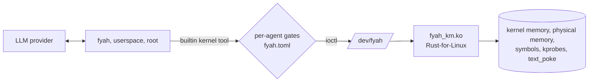

# fyah

Fyah is an agent harness. The agent loop, providers, tools and UI all run in
userspace. To reach the running kernel, fyah uses a small companion kernel
module, `fyah_km`. The module is not an agent. It is a privileged primitive
layer that exposes `/dev/fyah`, and the `kernel` builtin tool drives it with one
`ioctl` per call.



> **Warning.** On purpose, an agent with the `kernel` tool can write kernel
> memory, write physical memory and call any kernel address. That can crash
> the machine, corrupt filesystems or open security holes. Test in a VM first
> (see [Testing in a VM](#testing-in-a-vm)). You decide whether to load the
> module on a real host.

## Requirements

- x86-64 Linux. The module is built for one exact kernel. The current target is
  **7.2.15** from `linuxPackages_7_2`, with `CONFIG_RUST=y` and
  `CONFIG_KPROBES=y`.
- The kernel's build tree, plus the exact `rustc` and `bindgen` the kernel was
  built with. Rust-for-Linux refuses a module built with a different toolchain.
- `CAP_SYS_ADMIN`. In practice this means running fyah as root. Without it,
  opening `/dev/fyah` fails with `EPERM`.

## 1. Build the module

The module source lives in `kmod/fyah_km/` (`fyah_km.rs`, `Kbuild`, `Makefile`).
It is a separate out-of-tree build. It is not part of the Cargo workspace.

### With Nix (recommended)

```sh
nix build .#fyah-km
# -> result/lib/modules/7.2.15/extra/fyah_km.ko
```

`nix/kmod.nix` builds against `linux_7_2` from the flake input
`nixpkgs-host`, which is the nixpkgs revision the host booted. It uses the
matching `rustc`, `bindgen` and `rustLibSrc`, so the version, config and
vermagic match the running kernel. If the host moves to another nixpkgs
revision, update `nixpkgs-host` in `flake.nix`.

### With a kernel build tree

```sh
cd kmod/fyah_km
make KDIR=/lib/modules/$(uname -r)/build   # KDIR defaults to that path
# -> kmod/fyah_km/fyah_km.ko
make clean
```

You may need to pass the same toolchain variables the kernel was built with,
for example `RUSTC=`, `BINDGEN=` and `RUST_LIB_SRC=`. `nix/kmod.nix` shows the
full list. Build outputs are git-ignored.

## 2. Load it

```sh
sudo insmod result/lib/modules/7.2.15/extra/fyah_km.ko   # or kmod/fyah_km/fyah_km.ko
ls -l /dev/fyah            # misc device, root only
sudo dmesg | tail -n 1     # fyah_km: loaded, /dev/fyah ready

sudo rmmod fyah_km         # detaches any live probes, frees module allocations
```

## 3. Build and run fyah

```sh
cargo build
sudo ./target/debug/fyah --agent root
```

CLI flags: `--config <path>` (default `fyah.toml`), `--agent <name>` (default
`default`), `--ctrl-c immediate|graceful` and `--debounce <ms>`.

## 4. Configure an agent

`kernel` is a builtin, so it needs no `[tools.*]` or `[executables.*]` entry.
To give an agent the tool, list `kernel` in its `tools`. Then turn on only the
op groups the agent needs:

```toml
[agents.root]
system_prompt = "You are Fyah, a system administration agent with full access to this machine"
provider = "openrouter"
model = "nemotron"
tools = ["read", "write", "bash", "kernel"]
dirs = [{ path = "/", write = true }]      # read/write reach everything
kernel = { write = true, phys = true, call = true, probe = true }   # confirm = true is implied

# Optional. These are the defaults.
[builtins]
kernel = { device = "/dev/fyah", max_bytes = 65536 }   # max_bytes caps read output
```

Every op-group gate is `false` by default. When an op is disabled, fyah
returns an error to the model and never opens the device.

| Gate      | Ops it unlocks                                              |
|-----------|-------------------------------------------------------------|
| always on | `version`, `lookup`, `read`                                 |
| `write`   | `write`, `patch`                                            |
| `phys`    | `read_phys`, `write_phys`                                   |
| `call`    | `call`, `alloc`, `free`                                     |
| `probe`   | `probe_attach`, `probe_detach`, `probe_stats`, `probe_list` |

### Confirmation

Ops that change kernel state ask on the terminal before running: `write`,
`write_phys`, `patch`, `call` and `probe_attach`.

```
Confirm: kernel: write 1 bytes at 0xffffffffc0a01000? [y/N]
```

The next line you type answers the question instead of going to the agent.
Only `y` or `yes` approves. Anything else, including an empty line or a
closed stdin, refuses. The model then gets the error `the user refused this
kernel operation`, and the device is never opened. When several calls are
waiting, they're asked one at a time, oldest first. Set `confirm = false` in
the agent's `kernel = { … }` to skip the prompt for unattended runs.

These gates and the prompt control what the tool offers, and the module logs
every request to dmesg (`fyah_km: req N op … addr … len …` and then
`fyah_km: req N status …`). They are **not a security boundary**. An agent that runs as root with `bash` can open
`/dev/fyah` itself.

## The `kernel` tool

The model sends JSON with an `op` and that op's fields. Addresses can be
numbers or `"0x…"` strings. `hex` payloads may contain spaces and `_`.

| Op             | Fields                       | What it does                                                         |
|----------------|------------------------------|----------------------------------------------------------------------|
| `version`      | none                         | Reports the module ABI version (fyah checks it on every call)        |
| `lookup`       | `name`                       | Symbol to address: tries `/proc/kallsyms` first, then a throwaway kprobe |
| `read`         | `addr`, `len` (default 64)   | Hex dump of kernel virtual memory. A bad address gives `EFAULT`, not an oops |
| `write`        | `addr`, `hex`                | Raw write to kernel virtual memory (no fault protection)             |
| `read_phys`    | `addr`, `len`, `mmio`        | Reads physical memory through `memremap` (write-back, or write-combined if `mmio`) |
| `write_phys`   | `addr`, `hex`, `mmio`        | Writes physical memory                                               |
| `call`         | `addr` or `name`, `args` (≤6 integers) | Calls a kernel function and returns its value               |
| `alloc`        | `len` (default 4096, ≤256 KiB) | Allocates a buffer that the module owns                            |
| `free`         | `addr`                       | Frees a buffer that `alloc` returned                                 |
| `probe_attach` | `name`                       | Puts a kprobe on a function that counts hits and records the last IP and time |
| `probe_detach` | `id`                         | Removes a probe                                                      |
| `probe_stats`  | `id`                         | Hits, last IP and last timestamp (ns)                                |
| `probe_list`   | none                         | Every live probe                                                     |
| `patch`        | `addr` or `name`, `hex`      | Patches kernel text: copies `hex` into a module buffer, then calls `text_poke` |

Examples of what a model would send:

```json
{"op": "lookup", "name": "jiffies"}
{"op": "read", "addr": "0xffffffff8a405000", "len": 8}
{"op": "probe_attach", "name": "do_sys_openat2"}
{"op": "probe_stats", "id": 1}
{"op": "call", "name": "ktime_get_mono_fast_ns"}
```

Limits: a single transfer is at most 1 MiB, and `read` output is also capped
by `builtins.kernel.max_bytes`. Symbol names must be shorter than 64 bytes.
A call has a 60 s timeout.

## Testing in a VM

```sh
nix build .#checks.x86_64-linux.fyah-km -L   # needs /dev/kvm, about 30 s once built
```

`nix/kmod-test.nix` is a NixOS test that boots the same 7.2.15 kernel and
loads the module. It then runs `kmod/fyah_km/kmod_test.rs`, which exercises
version, alloc, write, read and free, a bad address returning `EFAULT`,
read_phys, lookup, a call to `ktime_get`, and a kprobe on `__x64_sys_getpid`
that must record a hit. That binary is a standalone client with no shared
code, so it also proves that both sides agree on the request layout. Last,
the test checks the dmesg request log, runs `rmmod`, checks that the device is
gone, and fails on any `Oops`, `BUG:` or `Call Trace`. Always run this test
before loading the module on a host.

## ABI

There is one `ioctl` (`_IOWR(0xf7, 0, Request)`) on a fixed `repr(C)` `Request`
struct. Its layout is defined three times, and all three must match:

- `kmod/fyah_km/fyah_km.rs` (module)
- `src/tools/kernel.rs` (fyah)
- `kmod/fyah_km/kmod_test.rs` (VM test)

If you change the struct or the op numbers, bump `ABI_VERSION` in all three.
When fyah and the module disagree on the version, fyah refuses to run any op
and tells you to rebuild the module.

## Troubleshooting

| Symptom                                   | Cause                                                       |
|-------------------------------------------|-------------------------------------------------------------|
| `insmod: Invalid module format`           | Wrong kernel or toolchain: rebuild against the running kernel |
| `kernel device /dev/fyah: No such file…`  | The module isn't loaded, or `device` points to another path |
| `kernel device /dev/fyah: Operation not permitted` | fyah isn't running with `CAP_SYS_ADMIN`            |
| `kernel <gate> access is not enabled for this agent` | Turn on that gate in the agent's `kernel = { … }` |
| `the user refused this kernel operation`  | You answered something other than `y`/`yes`, or stdin is closed |
| `fyah_km ABI mismatch`                    | The module and fyah come from different revisions           |
| `symbol not found`                        | The symbol isn't in kallsyms and kprobes can't resolve it   |
