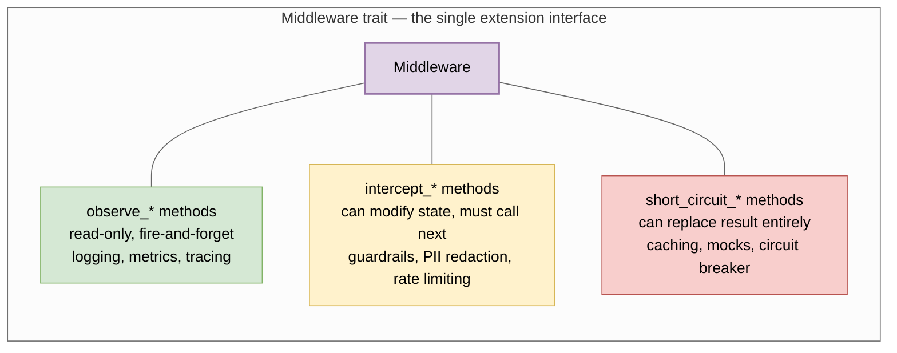
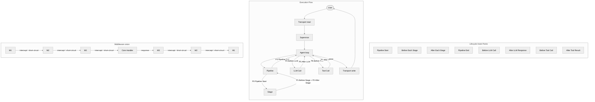
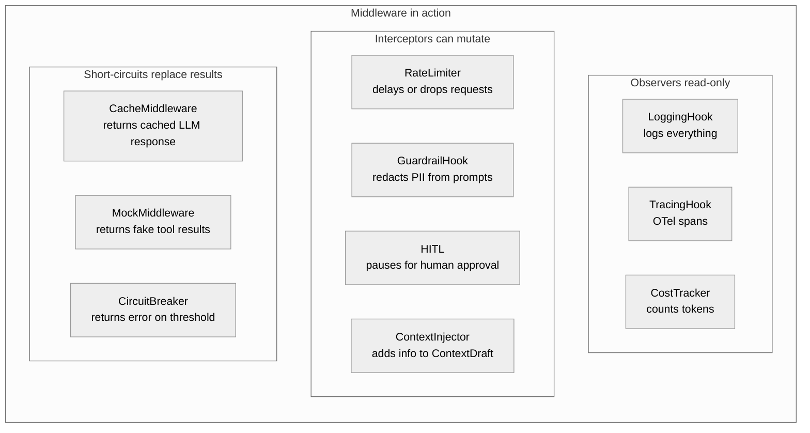
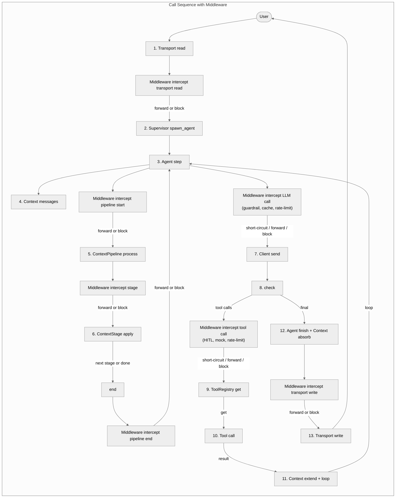
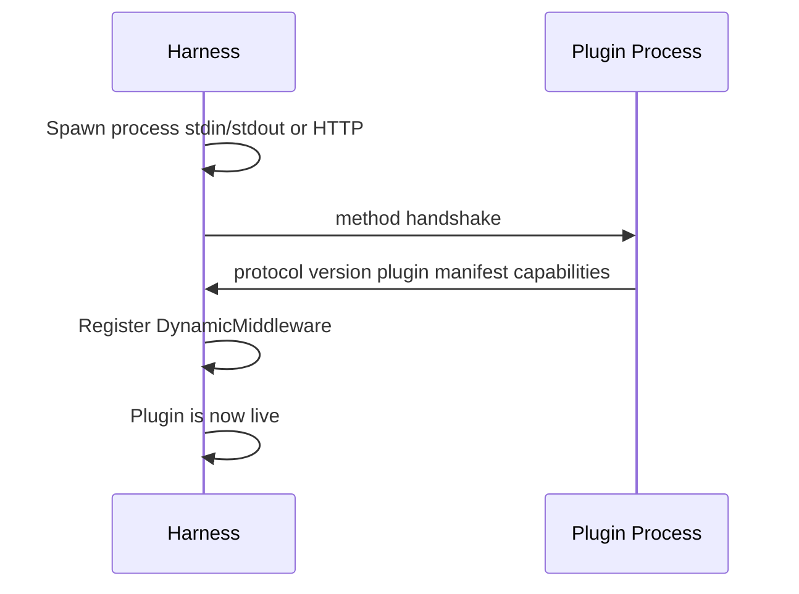
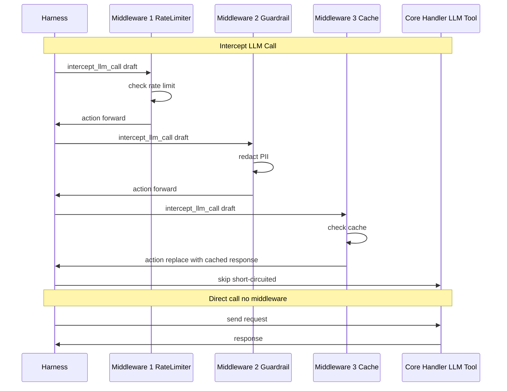
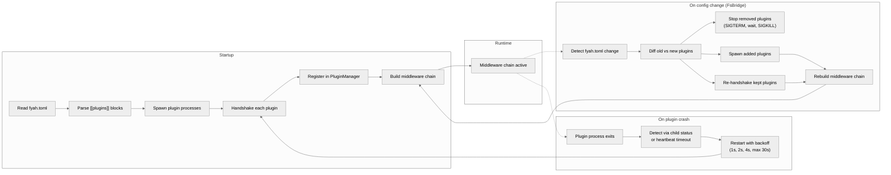

# Trait & Call Flow Architecture

## Three Kinds of Extension Point

There are three levels of influence an extension can have over the execution flow:

| Level | Can do | Example |
|-------|--------|---------|
| **Observe** | Read state, log, emit metrics | Logging, tracing, cost tracking |
| **Intercept** | Read + modify state before passing on | PII redaction, prompt injection, rate limiting |
| **Short-circuit** | Replace the result entirely, skip execution | Cache hit, mock/stub, circuit breaker |

The current `Hook` trait only supports **Observe**. This needs to evolve into a proper **Middleware** system that supports all three.

---

## The Middleware Trait (replaces pure-observation Hook)



## The lifecycle points each Middleware can hook into



---

## Updated Middleware Trait Design

```rust
/// Outcome of a middleware interception — allows short-circuiting.
pub enum Intercept<T, E> {
    /// Let the data pass through (possibly modified).
    Forward(T),
    /// Block execution with an error.
    Block(E),
    /// Replace the result entirely (short-circuit).
    Replace(Result<T, E>),
}

/// A middleware that can observe, intercept, or short-circuit
/// at every lifecycle point.
pub trait Middleware: Send + Sync {
    fn name(&self) -> &str;

    // ── Pure observation (read-only) ──────────────────────────

    fn on_pipeline_start(&self, _draft: &ContextDraft) {}
    fn on_stage_executed(&self, _stage: &str, _result: &Result<(), StageError>) {}
    fn on_llm_response(&self, _latency: std::time::Duration) {}
    fn on_tool_result(&self, _tool: &str, _result: &Result<String, ToolError>) {}
    fn on_cancelled(&self) {}

    // ── Interception (can modify) ─────────────────────────────

    fn intercept_pipeline_start(
        &self,
        draft: ContextDraft,
        next: PipelineFn,
    ) -> Result<ContextDraft, StageError> {
        next(draft)
    }

    fn intercept_stage(
        &self,
        stage: &dyn ContextStage,
        draft: ContextDraft,
        next: StageFn,
    ) -> Result<ContextDraft, StageError> {
        next(stage, draft)
    }

    fn intercept_llm_call(
        &self,
        draft: ContextDraft,
        client: &dyn Client,
        next: LlmFn,
    ) -> Result<Vec<Message>, AgentError> {
        next(draft, client)
    }

    fn intercept_tool_call(
        &self,
        tool: &dyn Tool,
        args: serde_json::Value,
        next: ToolFn,
    ) -> Result<String, ToolError> {
        next(tool, args)
    }

    fn intercept_transport_read(
        &self,
        transport: &mut dyn Transport,
        next: TransportReadFn,
    ) -> Result<String, TransportError> {
        next(transport)
    }

    fn intercept_transport_write(
        &self,
        msg: &str,
        transport: &mut dyn Transport,
        next: TransportWriteFn,
    ) -> Result<(), TransportError> {
        next(msg, transport)
    }

    // ── Short-circuit helpers (convenience) ───────────────────

    /// Can this middleware short-circuit the LLM call with a cached result?
    fn cached_llm_response(&self, _draft: &ContextDraft) -> Option<Vec<Message>> {
        None
    }

    /// Can this middleware short-circuit a tool call with a mocked result?
    fn mocked_tool_result(&self, _tool: &str, _args: &serde_json::Value) -> Option<String> {
        None
    }
}
```

## How the middleware onion wraps the call flow

```mermaid
%%{init: {'flowchart': {'htmlLabels': true, 'curve': 'basis'}, 'theme': 'neutral'}}%%
flowchart TB

  subgraph ORCH["Middleware Orchestration"]
    direction TB

    MW["MiddlewareChain
      Vec[Box[dyn Middleware]]"]:::data
    PIPE["ContextPipeline
      Vec[Box[dyn ContextStage]]"]:::data

    subgraph LLM_CALL["LLM Call Path"]
      direction LR
      M1a["RateLimiter"]:::middleware
      M2a["Guardrail<br/>PII redact"]:::middleware
      M3a["Cache<br/>short-circuit"]:::middleware
      CLIENT["Client.send"]:::core
      M3b["Cache store"]:::middleware
      M2b["Guardrail post"]:::middleware
      M1b["Cost tracker"]:::middleware

      M1a -->|"intercept"| M2a
      M2a -->|"intercept"| M3a
      M3a -->|"short-circuit<br/>or forward"| CLIENT
      CLIENT -->|"response"| M3b
      M3b --> M2b
      M2b --> M1b
    end

    subgraph TOOL_CALL["Tool Call Path"]
      direction LR
      T1a["RateLimiter"]:::middleware
      T2a["HITL<br/>approval"]:::middleware
      T3a["Mock<br/>short-circuit"]:::middleware
      TOOL["Tool.call"]:::core
      T3b["Audit log"]:::middleware
      T2b["Result filter"]:::middleware
      T1b["Metrics"]:::middleware

      T1a --> T2a
      T2a --> T3a
      T3a --> TOOL
      TOOL --> T3b
      T3b --> T2b
      T2b --> T1b
    end
  end

  classDef data fill:#dae8fc,stroke:#6c8ebf
  classDef middleware fill:#fff2cc,stroke:#d6b656,stroke-dasharray:5 3
  classDef core fill:#d5e8d4,stroke:#82b366
```



## Concrete examples of what each middleware does



## How dynamic plugins map to middleware

The `Middleware` trait has a corresponding `DynamicMiddleware` adapter, same as all other traits:

```
DynamicMiddleware: implements Middleware trait
    → delegates intercept_*/observe_* → PluginEndpoint
        → stdio/HTTP/MCP → external process (any language)
```

A Python script can:

```python
# Observe mode: just log
{ "method": "on_llm_response", "params": { "latency": 1.2 } }

# Intercept mode: modify the draft before LLM
{ "method": "intercept_llm_call",
  "params": { "draft": { "messages": [...] } },
  "response": { "action": "forward", "draft": { "messages": [modified...] } } }

# Short-circuit mode: return cached result
{ "method": "intercept_llm_call",
  "params": { "draft": { "messages": [...] } },
  "response": { "action": "replace", "result": [cached_messages...] } }
```

---

## Full Layer Diagram — All Traits

```mermaid
%%{init: {'flowchart': {'htmlLabels': true, 'curve': 'basis'}, 'theme': 'neutral'}}%%
flowchart TB

  subgraph L0["0. Core Data"]
    CB[ContentBlock]
    M[Message]
    R[Role]
  end

  subgraph L1["1. Storage"]
    MS[MessageStore trait]
    CTX[Context trait]
    SC[SimpleContext]
    SW[SlidingWindowContext]
    CTX -->|extends| MS
    SC -->|impl| CTX
    SW -->|impl| CTX
  end

  subgraph L2["2. Pipeline"]
    CST[ContextStage trait]
    CPL[ContextPipeline]
    CMP[Compactor trait]
    ISP[InjectSystemPrompt]
    ATB[AllocateTokenBudget]
    CSC[CompressContext]
    SFS[SelectFiles]
    ISP -->|impl| CST
    ATB -->|impl| CST
    CSC -->|impl| CST
    SFS -->|impl| CST
    CPL -->|process iterates| CST
    CSC -->|delegates to| CMP
  end

  subgraph L3["3. Middleware"]
    MDW[Middleware trait]
    LGH[LoggingHook]
    TRH[TracingHook]
    CSTC[CostTracker]
    GRD[GuardrailHook]
    HITL[HumanInTheLoop]
    RTL[RateLimiter]
    CCH[CacheMiddleware]
    MOCK[MockMiddleware]
    LGH -->|impl observe| MDW
    TRH -->|impl observe| MDW
    CSTC -->|impl observe| MDW
    GRD -->|impl intercept| MDW
    HITL -->|impl intercept| MDW
    RTL -->|impl intercept| MDW
    CCH -->|impl short-circuit| MDW
    MOCK -->|impl short-circuit| MDW
  end

  subgraph L4["4. Client"]
    CLT[Client trait]
    OAI[OpenAIClient]
    ANT[AnthropicClient]
    OLL[OllamaClient]
    OAI -->|impl| CLT
    ANT -->|impl| CLT
    OLL -->|impl| CLT
  end

  subgraph L5["5. Agent"]
    AGT[Agent trait]
    SO[StepOutcome]
    CT[CancellationToken]
    REA[ReActAgent]
    PLA[PlannerAgent]
    REF[ReflectiveAgent]
    REA -->|impl| AGT
    PLA -->|impl| AGT
    REF -->|impl| AGT
  end

  subgraph L6["6. Tools"]
    TLT[Tool trait]
    TLR[ToolRegistry trait]
    BSH[BashTool]
    RF[ReadFileTool]
    MCP[McpToolProxy]
    BSH -->|impl| TLT
    RF -->|impl| TLT
    MCP -->|impl| TLT
    TLR -->|returns| TLT
  end

  subgraph L7["7. Transport"]
    TRT[Transport trait]
    STD[StdinTransport]
    TCP[TcpTransport]
    WS[WebSocketTransport]
    STD -->|impl| TRT
    TCP -->|impl| TRT
    WS -->|impl| TRT
  end

  subgraph L8["8. Supervisor"]
    SVT[Supervisor trait]
    SSE[SingleSessionSupervisor]
    MAE[MultiAgentSupervisor]
    SSE -->|impl| SVT
    MAE -->|impl| SVT
  end

  subgraph L9["9. Dynamic Plugin Layer"]
    PE[PluginEndpoint]
    PM[PluginManifest]
    PR[PluginRegistry]
    DTL[DynamicTool]
    DST[DynamicStage]
    DCM[DynamicCompactor]
    DCL[DynamicClient]
    DMD[DynamicMiddleware]
    MCPP[MCP Server]
    STDP[stdio Plugin]
    HTTPP[HTTP Plugin]
    DTL -->|delegates to| PE
    DST -->|delegates to| PE
    DCM -->|delegates to| PE
    DCL -->|delegates to| PE
    DMD -->|delegates to| PE
    PE -->|stdio| STDP
    PE -->|http| HTTPP
    PE -->|mcp| MCPP
    PR -->|creates| DTL
    PR -->|creates| DST
    PR -->|creates| DCM
    PR -->|creates| DCL
    PR -->|creates| DMD
    PE -->|handshake| PM
    PM -->|registered in| PR
  end

  classDef trait fill:#e1d5e7,stroke:#9673a6,stroke-width:2px
  classDef data fill:#dae8fc,stroke:#6c8ebf,stroke-width:1px
  classDef dynamic fill:#fff2cc,stroke:#d6b656,stroke-width:2px,stroke-dasharray:5 3
  classDef external fill:#f8cecc,stroke:#b85450,stroke-width:1px

  class MS,CTX,CST,CMP,CLT,AGT,TLT,TLR,TRT,SVT,MDW trait
  class CB,M,R,SC,SW,CPL,ISP,ATB,CSC,SFS,SO,CT,REA,PLA,REF,BSH,RF,MCP,STD,TCP,WS,SSE,MAE data
  class LGH,TRH,CSTC,GRD,HITL,RTL,CCH,MOCK data
  class PE,PM,PR,DTL,DST,DCM,DCL,DMD dynamic
  class MCPP,STDP,HTTPP external
```



## Call Flow — With Middleware Orchestration



## Trait Dependency Map (who calls what)

| Caller | Trait | Methods | Purpose |
|--------|-------|---------|---------|
| **Supervisor** | `Context` via `MessageStore` | `messages`, `extend`, `absorb` | reads/writes session history |
| **Supervisor** | `Transport` | `read`, `write` | user I/O |
| **Supervisor** | `Client` | `send` | creates LLM client per agent |
| **Supervisor** | `ContextPipeline` | `process` | builds pipeline from config |
| **Supervisor** | `Middleware` | `on_pipeline_start` | observes pipeline creation |
| **Agent** | `Context` via `MessageStore` | `messages`, `extend` | builds draft, stores results |
| **Agent** | `CancellationToken` | `is_cancelled` | cancellation check each step |
| **Agent** | `ContextPipeline` | `process` | runs all pipeline stages |
| **Agent** | `Middleware` | `intercept_pipeline_start/end` | wraps pipeline execution |
| **Agent** | `Middleware` | `intercept_llm_call` | wraps LLM call |
| **Agent** | `Middleware` | `intercept_tool_call` | wraps tool execution |
| **Agent** | `Client` | `send` | calls the LLM API |
| **Agent** | `ToolRegistry` | `get` | resolves tool calls |
| **Agent** | `Tool` | `call` | executes each tool |
| **ContextPipeline** | `ContextStage` | `apply` | runs each stage in order |
| **ContextPipeline** | `Middleware` | `intercept_stage` | wraps each stage |
| **Supervisor** | `Middleware` | `intercept_transport_read/write` | wraps transport I/O |

## Middleware vs ContextStage — When to Use Which

| Aspect | ContextStage | Middleware |
|--------|-------------|-----------|
| Runs when | Inside pipeline, before LLM call | Around everything (pipeline, LLM, tools, transport) |
| Can observe | No | Yes |
| Can mutate draft | Yes | Yes |
| Can short-circuit | No (must run) | Yes (skip LLM call entirely) |
| Typical use | Inject system prompt, select files, compress context | Guardrails, caching, rate limiting, HITL, audit |
| Runs per | Pipeline execution | Every lifecycle event |
| Implementation | Native Rust or DynamicStage | Native Rust or DynamicMiddleware |

---

## How Cross-Language Plugins Plug Into the Harness

This section covers the concrete mechanism: discovery, handshake, runtime protocol, and lifecycle.

### 1. Discovery — Two Sources

Plugins are discovered from two places, merged at startup:

```toml
# fyah.toml — explicit declaration (deterministic, auditable)

[plugins]

  [[plugins.middleware]]
  name = "pii-redactor"
  transport = "stdio"
  command = "python3 plugins/pii_redactor.py"
  order = 1

  [[plugins.middleware]]
  name = "llm-cache"
  transport = "http"
  url = "http://127.0.0.1:9100"
  order = 2

  [[plugins.middleware]]
  name = "human-approval"
  transport = "stdio"
  command = "node plugins/approval.mjs"
  order = 3

  [[plugins.tools]]
  name = "weather-api"
  transport = "mcp"
  command = "python3 plugins/weather_mcp_server.py"
```

```
~/.config/fyah/plugins/          ← filesystem scanning (hot-plug)
  my-custom-plugin/
    plugin.toml                   ← same structure as the TOML block
    plugin.py
```

### 2. Plugin Manifest (plugin.toml)

```toml
[plugin]
name = "pii-redactor"
version = "2.1.0"
description = "Redacts PII before LLM calls"

[transport]
type = "stdio"        # stdio | http | unix_socket | mcp
command = "python3 pii_redactor.py"
# For HTTP:
# url = "http://127.0.0.1:9200"

[capabilities]
# Which lifecycle points this plugin hooks into
on_pipeline_start = false
on_stage_executed = false
on_llm_response = true
on_tool_result = false
on_cancelled = false

intercept_transport_read = false
intercept_transport_write = false
intercept_pipeline_start = false
intercept_pipeline_end = false
intercept_stage = false
intercept_llm_call = true
intercept_tool_call = false
```

### 3. Handshake — Plugin Advertises Its Capabilities

When the harness starts a plugin, they do a one-time handshake:





#### Wire Format — Request (Harness to Plugin)

```json
{
  "id": "call_001",
  "method": "intercept_llm_call",
  "params": {
    "draft": {
      "messages": [
        {"role": "user", "content": "Hello, my SSN is 123-45-6789"}
      ],
      "model": "gpt-4o",
      "budget": {"capacity": 4096, "consumed": 120}
    }
  }
}
```

#### Wire Format — Response (Plugin to Harness)

Three possible actions:

```json
// ── Forward (pass through, possibly modified) ──
{
  "id": "call_001",
  "action": "forward",
  "draft": {
    "messages": [
      {"role": "user", "content": "Hello, my SSN is [REDACTED]"}
    ]
  }
}

// ── Block (abort with error) ──
{
  "id": "call_001",
  "action": "block",
  "error": "Rate limit exceeded. Try again in 30 seconds."
}

// ── Replace / Short-circuit (skip downstream) ──
{
  "id": "call_001",
  "action": "replace",
  "result": [
    {"role": "assistant", "content": "I cannot process requests containing PII."}
  ]
}

// ── Continue (for observe-only methods) ──
{
  "id": "call_001",
  "action": "continue"
}
```

### 5. Rust Implementation — The Adapter Chain

```rust
// ── Transport abstraction for reaching the plugin ──

pub enum PluginTransport {
    Stdio {
        stdin: BufWriter<ChildStdin>,
        stdout: BufReader<ChildStdout>,
    },
    Http {
        client: reqwest::Client,
        url: String,
    },
    UnixSocket {
        stream: UnixStream,
    },
}

impl PluginTransport {
    pub fn call(&mut self, req: &PluginRequest) -> Result<PluginResponse, PluginError> {
        match self {
            Self::Stdio { stdin, stdout } => {
                // Write one JSON line to stdin
                serde_json::to_writer(stdin.as_mut(), req)?;
                stdin.write_all(b"\n")?;
                stdin.flush()?;
                // Read one JSON line from stdout
                let mut line = String::new();
                stdout.read_line(&mut line)?;
                Ok(serde_json::from_str(&line)?)
            }
            Self::Http { client, url } => {
                let resp = client.post(url).json(req).send().await?;
                Ok(resp.json()?)
            }
        }
    }
}

// ── Plugin lifecycle handle ──

pub struct PluginInstance {
    name: String,
    manifest: PluginManifest,
    transport: PluginTransport,
    child: Option<Child>,  // None for remote HTTP plugins
}

impl PluginInstance {
    pub fn capabilities(&self) -> &Capabilities {
        &self.manifest.capabilities
    }

    pub fn call(&mut self, req: &PluginRequest) -> Result<PluginResponse, PluginError> {
        self.transport.call(req)
    }
}

// ── PluginManager — owns all plugins, handles lifecycle ──

pub struct PluginManager {
    plugins: HashMap<String, PluginInstance>,
    /// File-system watcher for hot-reload
    watcher: Option<NotifyWatcher>,
}

impl PluginManager {
    /// Load plugins from config file
    pub fn load_config(&mut self, config: &PluginsConfig) -> Result<()> {
        for def in &config.plugins {
            let instance = self.spawn_plugin(def)?;
            self.plugins.insert(def.name.clone(), instance);
        }
        Ok(())
    }

    /// Spawn a plugin process, do handshake, return handle
    fn spawn_plugin(&self, def: &PluginDef) -> Result<PluginInstance, PluginError> {
        let (transport, child) = match &def.transport {
            TransportDef::Stdio { command } => {
                let mut child = Command::new("sh")
                    .arg("-c")
                    .arg(command)
                    .stdin(Stdio::piped())
                    .stdout(Stdio::piped())
                    .stderr(Stdio::inherit())
                    .spawn()?;
                let stdin = child.stdin.take().unwrap();
                let stdout = child.stdout.take().unwrap();
                (PluginTransport::Stdio {
                    stdin: BufWriter::new(stdin),
                    stdout: BufReader::new(stdout),
                }, Some(child))
            }
            TransportDef::Http { url } => {
                let client = reqwest::Client::new();
                (PluginTransport::Http { client, url: url.clone() }, None)
            }
        };

        // Handshake
        let manifest: PluginManifest = transport.call(&PluginRequest::handshake())?;
        Ok(PluginInstance { name: def.name.clone(), manifest, transport, child })
    }

    /// Build the middleware chain from registered plugins
    pub fn middleware_chain(&mut self) -> MiddlewareChain {
        let mut chain = MiddlewareChain::new();
        let mut ordered: Vec<&mut PluginInstance> = self.plugins
            .values_mut()
            .filter(|p| p.manifest.is_middleware())
            .collect();
        ordered.sort_by_key(|p| p.manifest.plugin.order);
        for plugin in ordered {
            chain.push(DynamicMiddleware::new(plugin));
        }
        chain
    }
}

// ── DynamicMiddleware — implements Middleware trait by delegating to plugin ──

pub struct DynamicMiddleware<'a> {
    plugin: &'a mut PluginInstance,
}

impl Middleware for DynamicMiddleware<'_> {
    fn name(&self) -> &str {
        &self.plugin.name
    }

    fn intercept_llm_call(
        &mut self,
        draft: ContextDraft,
        next: LlmFn,
    ) -> Result<Vec<Message>, AgentError> {
        if !self.plugin.capabilities().intercept_llm_call {
            return next(draft);
        }

        let req = PluginRequest::new("intercept_llm_call", &draft);
        match self.plugin.call(&req)? {
            PluginResponse { action: Action::Forward, draft: Some(modified), .. } => {
                next(modified)
            }
            PluginResponse { action: Action::Forward, draft: None, .. } => {
                next(draft)  // no modifications
            }
            PluginResponse { action: Action::Block, error: Some(e), .. } => {
                Err(AgentError::Blocked(e))
            }
            PluginResponse { action: Action::Replace, result: Some(r), .. } => {
                Ok(r)
            }
            _ => next(draft),
        }
    }
}
```

### 6. Concrete Example — A PII Redactor in Python

```python
#!/usr/bin/env python3
"""pii_redactor.py — A middleware plugin that redacts PII before LLM calls.

Protocol: JSON lines over stdio.
Usage:    The harness spawns this as a subprocess.
"""

import json, re, sys

# ── Handshake: tell the harness what I can do ──
handshake = {
    "protocol_version": "1.0",
    "plugin": {
        "name": "pii-redactor",
        "version": "2.1.0",
    },
    "capabilities": {
        "intercept_llm_call": True,
        "on_llm_response": True,   # observe only
    },
}
print(json.dumps(handshake), flush=True)

# ── PII patterns ──
PII_PATTERNS = [
    (re.compile(r"\b\d{3}-\d{2}-\d{4}\b"), "[SSN REDACTED]"),
    (re.compile(r"\b\d{16}\b"), "[CC REDACTED]"),
    (re.compile(r"[a-zA-Z0-9._%+-]+@[a-zA-Z0-9.-]+\.[a-zA-Z]{2,}"), "[EMAIL REDACTED]"),
]

def redact_pii(text: str) -> str:
    for pattern, replacement in PII_PATTERNS:
        text = pattern.sub(replacement, text)
    return text

# ── Main loop: read requests, write responses ──
for line in sys.stdin:
    req = json.loads(line)

    if req["method"] == "intercept_llm_call":
        draft = req["params"]["draft"]
        for msg in draft["messages"]:
            if msg["role"] in ("user", "assistant"):
                msg["content"] = redact_pii(msg["content"])

        resp = {
            "id": req["id"],
            "action": "forward",
            "draft": draft,
        }
        print(json.dumps(resp), flush=True)

    elif req["method"] == "on_llm_response":
        # Observe-only: just log (no state mutation)
        latency = req["params"].get("latency")
        log_entry = f"[pii-redactor] LLM response received, latency={latency}s"
        # (in a real plugin, write to a log file)
        resp = {"id": req["id"], "action": "continue"}
        print(json.dumps(resp), flush=True)
```

### 7. Hot-Reload Lifecycle



### 8. Plugin Manager Trait — The Public API

```rust
/// The central registry and lifecycle manager for all plugins.
pub trait PluginManager: Send + Sync {
    /// List all registered plugins.
    fn list_plugins(&self) -> Vec<PluginInfo>;

    /// Get a specific plugin by name.
    fn get_plugin(&self, name: &str) -> Option<&dyn PluginHandle>;

    /// Install a new plugin at runtime (hot-plug).
    fn install_plugin(&mut self, def: PluginDef) -> Result<(), PluginError>;

    /// Remove a plugin at runtime.
    fn uninstall_plugin(&mut self, name: &str) -> Result<(), PluginError>;

    /// Build the middleware chain from currently registered middleware plugins.
    fn build_middleware_chain(&mut self) -> MiddlewareChain;

    /// Restart a specific plugin (e.g. after config change).
    fn restart_plugin(&mut self, name: &str) -> Result<(), PluginError>;
}
```

### 9. Config in fyah.toml — Complete Example

```toml
[plugins]

  # ── Tool: external API via MCP ──
  [[plugins.tools]]
  name = "weather"
  transport = "mcp"
  command = "python3 mcp_servers/weather.py"

  # ── Tool: custom script via stdio ──
  [[plugins.tools]]
  name = "calc"
  transport = "stdio"
  command = "node tools/calculator.mjs"

  # ── Pipeline stage: RAG retrieval ──
  [[plugins.stages]]
  name = "retrieve_memories"
  transport = "stdio"
  command = "python3 stages/retriever.py"

  # ── Middleware: guardrail ──
  [[plugins.middleware]]
  name = "pii-redactor"
  transport = "stdio"
  command = "python3 middleware/pii_redactor.py"
  order = 1

  # ── Middleware: LLM response cache ──
  [[plugins.middleware]]
  name = "llm-cache"
  transport = "http"
  url = "http://127.0.0.1:9100"
  order = 2

  # ── Middleware: human approval for tools ──
  [[plugins.middleware]]
  name = "human-approval"
  transport = "stdio"
  command = "node middleware/approval.mjs"
  order = 3

  # ── Compactor: custom summarization ──
  [[plugins.compactors]]
  name = "semantic-summarizer"
  transport = "stdio"
  command = "python3 compactors/summarize.py"

[pipelines]
  [pipelines.coding]
  stages = [
    "inject_system_prompt",
    "retrieve_memories",          # dynamic stage from plugins
    "allocate_budget",
    "compress_context",
  ]
  compactor = "semantic-summarizer"  # dynamic compactor from plugins
```

### 10. Summary — The Complete Data Flow

```
User writes config in fyah.toml
         │
         ▼
PluginManager reads config, spawns processes, does handshake
         │
         ▼
Each plugin registers as DynamicTool / DynamicStage / DynamicMiddleware / etc.
         │
         ▼
At runtime, harness calls Middleware methods:
  Transport.read() → Middleware chain → Agent → Pipeline → Middleware → LLM
                                                                    → Middleware → Tool
         │
         ▼
Each Dynamic* adapter serializes the call to JSON
         │
         ▼
PluginTransport sends JSON over stdio/HTTP to the external process
         │
         ▼
External process (Python/Node/Rust/any language) processes and responds
         │
         ▼
Dynamic* adapter deserializes the response:
  "forward" → pass modified data to next handler
  "block"   → abort with error
  "replace" → skip downstream, use provided result
```
