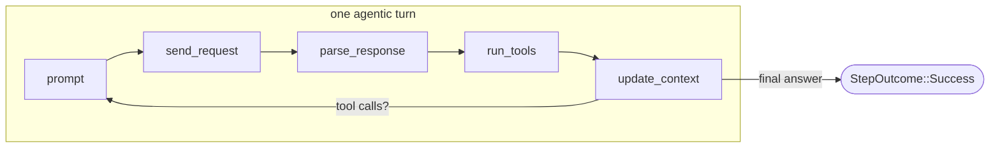

# The agent loop — parts, hooks, cancellation

The agentic loop that runs inside one workflow step's agent turn: a pipeline of
configurable **parts**, wrapped by per-part **hooks**, interruptible at every
await. Code lives in `src/llm/` (`runner.rs`, `parts.rs`, `hooks.rs`).

## Shape



The loop repeats the pipeline while the assistant message carries tool calls;
a final answer (or the agent's `max_iterations` budget) ends it with
`Success`. Errors map to `RunError` → `StepOutcome::Failure`; soft cancel →
`Cancelled`, hard cancel → `Aborted`.

## Parts (`src/llm/parts.rs`)

A [`Part`] is plain enum data (all variants fieldless, `Copy`) dispatched by
`match` in `run_part` — no trait objects. Variants today:

- `BuildPromptFromAgent` / `BuildPromptAllTools` — resolve the binding and
  build the wire provider from config references; also pick the tool selection
  the send stage will apply
- `SendRequest`, `ParseResponse`, `RunTools`, `UpdateContext`

Names resolve through a hot-reloadable `LoopRegistry` (`PartStore<LoopRegistry>`
on the config store). Built-in definitions sit behind reserved names
(`prompt`, `send_request`, `parse_response`, `run_tools`, `update_context`);
user entries in `[loop_parts.<name>]` shadow them. Reloads apply at the next
turn — the pipeline is resolved out of the watch synchronously each turn.

Per-stage state lives in an owned `TurnState` (provider, tool selection, raw
bytes, assistant message, tool calls/results), so any part can borrow the
session freely between stages; missing prerequisites are clean
`RunError::Pipeline` errors, not silent misordering.

### The prompt is shape-only

The request prompt (`Prompt<'a>` in `src/context/message.rs`) owns nothing:
messages are a slice of the session conversation, system text a `Cow` of the
agent config's string, tool definitions references into the registry's
precomputed set. The **send stage** assembles it from those borrows, encodes
it into a `RequestBuilder` (which owns the serialized body), and drops every
borrow before the transport await — assembling a request clones nothing.
Because hooks never touch the session, nothing else needs the prompt alive.
The per-format wire requests (`ChatRequest<'a>` in each `formats/*/dtos.rs`)
are equally reference-only: they borrow straight through from the IR prompt,
with owned strings only where a wire spec forces new text (JSON-as-string
tool-call arguments, `[ERROR]` prefixes, joined blocks). Responses stay
owned — they are parsed from bytes.

### Ordering

Agents may assemble their own pipeline: `[agents.<name>] loop = ["prompt", …]`.
Absent means the built-in default order. An unknown name fails with a clean
config error naming it.

## Hooks (`src/llm/hooks.rs`) — distinct from parts

Parts *implement* a stage; hooks *observe and gate* one. Config under
`[loop_hooks.<part-name>]`:

```toml
[loop_hooks.prompt]
pre  = [{ type = "command", command = "echo starting", timeout_secs = 5 }]
post = [{ type = "command", command = "echo done" }]
```

- Run via `sh -c` with `FYAH_LOOP_PART` / `FYAH_HOOK_PHASE` exported; exit 0 ⇒
  success. Only command backends are supported this pass; anything else is
  rejected at startup (`StartupError::InvalidLoopHooks`).
- Failure policies: a failed **pre** hook skips its part (the turn then fails
  through the normal prerequisite path); a failed **post** hook flips a
  successful stage into `RunError::Hook` → failure.
- Hook sets are resolved once per turn like the pipeline, so reloads apply at
  the next turn.

## Cancellation

Both tokens (`CancellationGuard` soft/hard) are selected against at **every**
await point: the transport round-trip, each tool process (`kill_on_drop`
terminates the child), and each hook process — plus a non-blocking check at
every turn boundary. A cancel discards the partial turn: nothing reaches the
conversation. Soft returns `Cancelled` (the runtime drains gracefully); hard
returns `Aborted`.

## Tool execution

Tool definitions are precomputed once at config compile (registry order) and
advertised by reference: the agent's strict allow-list picks from that set (or
every advertisable tool under `build_prompt_all_tools`). Executable backends
this pass: `shell` (runs the call's `command` argument via `sh -c`) and custom
function tools (run their retained `command` with args via `FYAH_TOOL_NAME` /
`FYAH_TOOL_ARGS`). Unknown or non-executable tools return an error tool result
rather than failing the turn. Registry reads follow **borrow-then-drop**: copy
what a stage needs out of the `watch::Ref` inside a sync scope, never hold a
guard across an `.await`. No shared-ownership helpers (`Arc`, clones) — hook
sets and parts resolve to owned minimal data or references per turn.

See also [overview.md](overview.md), [glossary.md](glossary.md),
[context-map.md](context-map.md).
