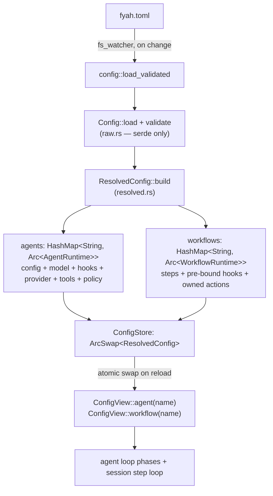

# Config Pipeline — raw TOML → runtime structures

> Current-state reference for `src/config/`. Verified against code on 2026-10-02 (after `config-resolution-main-loop` T11); stop/exit semantics, cycle guard, and snapshot coherence re-confirmed 2026-10-03.
> Hook-specific detail (slots, wire formats) lives in [hooks.md](hooks.md).

## Module map

| File | Responsibility |
|---|---|
| `src/config/mod.rs` | Facade. Submodule declarations, explicit `pub use`, `load_validated` — the single parse+validate entry point. |
| `src/config/raw.rs` | Serde structs exactly as `fyah.toml` describes them, plus cross-reference validation and `Config::validate`. No runtime state, no trait objects. |
| `src/config/resolved.rs` | The structures the loops execute against: `AgentRuntime`, `ResolvedConfig`, `HooksRepository`, `ResolvedHook`, `ProviderLogic`, `RequestPolicy`, `WorkflowRuntime`, `StepRuntime`, `StepKind`, `WorkflowHooks`. Leaf-module imports only. |
| `src/config/store.rs` | `ConfigStore` (single writer) + `ConfigView` (cheap clonable reader) over **one** `ArcSwap<ResolvedConfig>`. |
| `src/config/error.rs` | `ConfigError` + all user-facing wording. |

Layering rule: `resolved.rs` may import only leaf modules (`hooks`, `executable`, `context`, `model`, `provider`, `reqwest`). It must not import `agent`, `client`, `runtime`, `session`, or `communication` — trait *declarations* live there, implementations live with the behaviour they implement.

## Flow

Boot and hot reload both enter at `load_validated` (`src/main.rs`, `src/fs_watcher.rs`), so parse and validation can never diverge between them.

## What an `AgentRuntime` carries

Everything the loop needs, owned, with no name lookups and no per-iteration allocation:

| Field | Notes |
|---|---|
| `agent_config: AgentConfig` | Owned. Raw serde type, still the home of `limits`, `context`, hook `options`, and the `on_input` / `tool_execution` knobs. |
| `model: ModelConfig` | Owned copy, so the runtime struct does not borrow the provider. |
| `hooks: Arc<HooksRepository>` | 7 agent slots pre-bound to `Arc<Executable>`. The typed `&Hook<S>` is still borrowed from `AgentConfig`, which is why `Hook<T>` needs no `Clone`. |
| `provider: Arc<dyn ProviderLogic>` | Per **provider**, shared by all its agents. Owns `url` + `api_key`. |
| `tools: Arc<[Tool]>` | LLM tool definitions, resolved **once**. Tool *names* are not consulted again. |
| `context_policy: Arc<dyn ContextPolicy>` | The strategy named by `[agents.<name>.context] strategy`, chosen once. Stateless — it still takes `&ContextConfig` per call. |
| `request: RequestPolicy` | The inbound policy named by `[agents.<name>.on_input`: `FireAndForget` \| `Queue` \| `Interrupt`. Config data; `agent::request::driver_for` turns it into a `Box<dyn RequestDriver>` once per request phase — see [Request drivers](#request-drivers). |
| `request_max_tokens` | Pre-computed `min(model.max_tokens, limits.max_output_tokens_per_turn)`. |
| `max_iterations`, `max_concurrent_tools` | Copied out of the config. |

`HooksRepository::resolve` and `logic_for` both run inside `ResolvedConfig::build`, i.e. **once per config generation**, never per turn. A slot whose executable cannot be resolved stays `None` and the loop skips it (fail-open). A missing provider or model is logged and the agent is omitted — readers then get `None` rather than a panic.

## Request drivers

`RequestPolicy` (`src/config/resolved.rs`) is the config-selected inbound policy; `RequestDriver` (`src/agent/request.rs`) is the object-safe trait, built from the policy once per request phase by `driver_for`. The trait is possible because T07b made `LlmClient` and `HookRunner` object-safe.

The rule that made this necessary, verified by compile probe on rustc 1.96:

| Trait method shape | `Box<dyn Trait>`? |
|---|---|
| generic params + `impl Future` | no — E0038 |
| non-generic + `impl Future` | no — E0038 |
| generic params + boxed future | no — E0038 |
| generic method present + a non-generic method added | no — E0038 |
| non-generic + boxed future | **yes** |

A driver needs the client (`LlmClient`) and the runner (`HookRunner`), so its
method must be non-generic → it can only be a trait object if those two traits
are object-safe. They are (T07b), so `Box<dyn RequestDriver>` (`src/agent/request.rs`,
built per request phase by `driver_for`) and `Box<dyn StepRunner>`
(`src/runtime.rs`, built per step by `step_runner_for`) both exist.

The full rule, verified by compile probe on rustc 1.96:

| Trait method shape | `Box<dyn Trait>`? |
|---|---|
| generic params + `impl Future` | no — E0038 |
| non-generic + `impl Future` | no — E0038 |
| generic params + boxed future | no — E0038 |
| generic method present + a non-generic method added | no — E0038 |
| non-generic + boxed future | **yes** |

So the fix was **not** only boxing futures: `HookRunner::run_hook<S: Slot>` had to move off the trait entirely, to a free `run_hook<S, R: HookRunner + ?Sized>`, leaving a non-generic type-erased `run_json` behind. One generic method anywhere disqualifies the whole trait.

`HookRunner::run_json` deliberately does **not** apply a slot fallback — `S::fallback` needs `S`, which the erased method cannot have. It returns `Ok(HookDecision)` for a produced decision (`HookDecision::none()` meaning "no decision") and `Err(ExecutableError)` for transport failures; the typed wrapper applies the fallback on both paths. `HookDecision` carries the captured `stdout_raw`/`stderr` alongside the value, because a shape mismatch is the one case where the raw output is what a script author needs to see. `LlmClient` likewise builds its request *outside* the async block so only `Send` values cross the await, and carries `Sync` as a supertrait so `&dyn LlmClient` is itself `Send`.

The failure path — error-streak counter, `on_error` hook, stop — is written **once** in `send_or_stop` and shared by all three behaviours, so they cannot drift apart.

Note the interaction with the phase: when `on_input` is set, a tool-less turn **waits for the next user message** rather than finishing. Tests must queue a `Stop` to end such a phase.

## Tool batch driver

`ToolBatchDriver` (`src/agent/batch.rs`) is the config-chosen policy for running one turn's tool batch. It works because `collect_batch` / `take_first` / `run_interruptible_batch` take no client or runner — unlike the request driver, which needed T07b first.

The four combinations of `tools_on_input` × `tool_execution` collapse to **two objects**, not four:

| Driver | `tools_on_input` unset | `queue` | `interrupt` |
|---|---|---|---|
| `SequentialDriver` | `collect_batch`, no drain | `collect_batch`, drain after appending | `run_interruptible_batch(WaitFor::All, Configured(keep\|discard))` |
| `AsyncDriver` | `take_first`, no drain | `take_first`, drain after appending | `run_interruptible_batch(WaitFor::First, ForceKeep)` — always keeps |

The 2×2 lives in `batch_policy`; `for_agent` turns it into a `Box<dyn ToolBatchDriver>`. `AsyncDriver` ignores `tools_interrupt_strategy` because results already pushed to `messages` cannot be retracted — discarding would leave the assistant message referencing missing tool results.

Two things the driver deliberately does **not** own, both because a non-generic method cannot take `HookRunner`:

- **`post_tool` hooks** stay in `run_tool_phase`, so the outcome is `Collected` rather than "done".
- **The final append.** Message order is load-bearing and differs per path, so the driver either appends everything itself (`Handled`, interrupt) or hands the pieces back in the order they must be applied (`Collected`: assistant → denials → results). On the interrupt path the denials go in *first*, because the interruptible batch owns its own pushes.

The driver is built **per phase** from the phase's own agent snapshot, not stored on `AgentRuntime` — its method needs `LoopState`, and `resolved.rs` may not import `agent`.

Known gap: the executor-gone → `Stopped` path is compiler-checked but untested; killing the executor from outside `tools.rs` needs its private sender.

## Reload semantics

`ConfigStore::replace` replaces the **whole** `ResolvedConfig` under one `ArcSwap` store and bumps a generation counter. It takes `&self` (the counter is atomic), so the `fs_watcher` processor thread owns the store without `mut` juggling, and returns the generation it stored so callers log the real value. The counter is `Relaxed` — publication ordering comes from the `ArcSwap` itself — and there is exactly one writer thread; a second writer needs a lock first. Consequences, all covered by tests in `src/config/store.rs` and `src/client.rs`:

- A reader never observes a mix of old and new agents.
- An agent removed from `fyah.toml` while a session runs makes `ConfigView::agent` return `None`; the loop reports it and fails the step (`AgentMissing` → `on_failure`).
- A phase takes `Arc<AgentRuntime>` once at its top, so a reload landing mid-phase cannot change half of what that phase sees. The request-failure path reads the `on_error` hook from that same snapshot, never re-looking the agent up.
- An `Arc<AgentRuntime>` already held keeps its own values after a reload.
- A step takes `Arc<WorkflowRuntime>` once per lap, so a reload that renames steps applies to the next step, never mid-step.

## Session loop

`src/runtime.rs` walks the workflow graph: `session_start` hook → repeat (resolve current step from `ConfigView::workflow`, `before` hooks, `step_runner_for(action)`, `after` hooks, route `on_success` / `on_failure`, stop at `"done"`) → `session_end` hook. Step actions run through `Box<dyn StepRunner>` (`LlmStep` runs the agent loop and maps its outcome; `CommandStep` runs `bash -c` and reports exit status). Shutdown (`shutdown_rx`, graceful Ctrl-C) is honoured on lap boundaries; a removed workflow or step ends the session with a notification instead of panicking.

Stop vs exit: a user `Stop` ends the *step* with success so the walk advances (this is what lets interactive `on_input` agents live inside workflows); only `Exit` ends the whole session. A reload that removes the agent mid-step fails the step (`AgentMissing` → `on_failure`) from either phase. The `session_end` binding is captured at session start, so a mid-session reload cannot skip the audit hook, and it receives the real message count.

Cycle guard: at most `MAX_SESSION_STEPS` (64) steps per session. Retry edges like `plan.on_failure = "plan"` are legitimate, but a cycle with no exit ends loudly (error log + notification + `Ok(false)`) instead of looping forever.

## Not built yet

Do not assume these exist:

- `hook.options()` (per-slot `options` like `verify_done.min_iterations`, `pre_prompt.max_tokens`, `step.abort_on_fail`) is parsed and stored but has **no runtime reader** — a pre-existing gap, not introduced by the refactor.
- Streaming/SSE: `attach_body_stream` and `StreamReconstructor` exist as free functions with no runtime caller.
- Per-step timeout enforcement: `timeout_secs` is parsed, validated, and carried on `StepRuntime`, but nothing enforces it.
