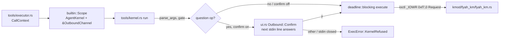

# Kernel layer (`fyah_km` + `kernel` builtin)

User docs: `README.md`. This file is the map for changing it.

## Pieces
- `kmod/fyah_km/fyah_km.rs`: Rust-for-Linux misc device `/dev/fyah`. `open` requires `CAP_SYS_ADMIN`. One ioctl, `dispatch` by `Request.op`. Logs `req N op … addr … len …` / `req N status …` per ioctl. `Drop` unregisters probes and frees leftover `alloc` buffers.
- `src/tools/kernel.rs`: client. `run` = parse → `gate` (per-agent op groups) → `question` (state-changing ops) → `OutboundChannel::confirm` → blocking `execute` (open device, version check, op). `patch` = alloc + write + `call text_poke` + free. `lookup` reads `/proc/kallsyms` first, module kprobe fallback.
- `src/config/parser.rs` `AgentKernel`: `write`, `phys`, `call`, `probe` (default false), `confirm` (default true). `[builtins] kernel = { device, max_bytes }`.
- `src/ui.rs`: single terminal task owns stdin and output; queues `Confirmation`s, oldest is answered by the next line (`y`/`yes` only).
- Gates and prompt are UX/audit, not security: root + `bash` can open the device directly.

## ABI invariants
- `Request` / `ProbeEntry` layout and `OP_*` numbers are duplicated in `fyah_km.rs`, `src/tools/kernel.rs`, `kmod/fyah_km/kmod_test.rs`. Change all three and bump `ABI_VERSION` together.
- Results: `value` (address, return value, probe id, count), `extra[0..2]` (probe last ip / ns), `status` (negative errno).

## Build and verify
- `nix build .#fyah-km`: module against `linux_7_2` of flake input `nixpkgs-host` (the host's booted revision; update it when the host updates).
- `nix build .#checks.x86_64-linux.fyah-km`: NixOS VM test, insmod → `kmod-test` → dmesg log check → rmmod → no Oops.
- Kbuild outputs in `kmod/` are git-ignored.
- Not covered: a fyah agent session driving the `kernel` tool inside the VM (needs a model in the VM).
