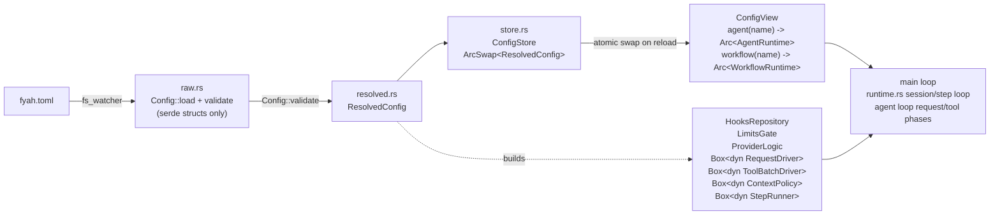

# Plan: config-resolution-main-loop — raw config (fs_watcher) → resolved runtime structs (Box<dyn>) → main loop

Decisions locked (from clarification round):
- **Baseline**: the tree is red. An uncommitted, non-compiling draft of *this same refactor* was found
  in `src/config.rs` (+147) and `src/provider/mod.rs` (+246, 61 errors, written 2026-10-01 23:32).
  Confirmed abandoned with no parallel writer: **discarded outright** by T01. Its good idea survives as
  the `ProviderLogic` name below; its bad shape (one `provider_logic` for the whole workspace,
  `apply_auth` stubbed to a no-op, traits referencing `agent::state`/`AgentView`) is explicitly rejected.
- **Scope**: everything — `main.rs` wiring, the session/workflow loop, and the agent loop.
- **Traits**: use `Box<dyn Trait>` for real behavioural divergence, keep enums/data where the
  variation is a value. All trait objects are `Send + Sync + 'static` so a whole resolved config can
  live in one `ArcSwap` and be hot-swapped.
- **Reload**: one `ArcSwap<ResolvedConfig>`. One atomic swap updates everything; readers take cheap
  `Arc` clones (`view.agent(name)`, `view.workflow(name)`). No generation chasing in the loop.
- **Layout**: `src/config.rs` becomes `src/config/` — `mod.rs`, `raw.rs`, `resolved.rs`, `store.rs`,
  `error.rs`. Existing `crate::config::*` paths stay valid via re-exports.
- **Naming**: the per-agent provider object is `Box<dyn ProviderLogic>` (name borrowed from the
  discarded draft) and it is **owned** — endpoint + auth + wire format + temperature + request cap —
  resolved per agent/model, never workspace-wide, and it can never be a no-op for auth.
- **Tool driver shape**: one `request()`-style method per driver impl, with `OnInput` +
  `InterruptPolicy` as data parameters (T08), *not* the discarded draft's 3-method
  `execute_batch`/`handle_queue`/`handle_interrupt` split.
- **T04 split (approved 2026-10-01)**: T04 was too large for one coherent commit, so it becomes
  T04a (hooks repository) → T04b (owned `ProviderLogic` transport) → T04c (`AgentRuntime` +
  `ResolvedConfig` + `ConfigView::agent()`). T04a and T04b are independent; T04c depends on both.
- **T07 split (approved 2026-10-01)**: `Box<dyn RequestDriver>` is not achievable as originally
  specified. Verified by compile probe on rustc 1.96: a trait method with a **generic parameter** is
  never dyn-compatible (E0038), and neither is an `impl Future` return (E0038). The only
  dyn-compatible shape is a **non-generic method returning a boxed future**. `RequestDriver` needs
  `deps.client`/`deps.runner` (both generic), so T07 becomes T07a (enum dispatch + dedup the
  triplicated error path, achievable now) → T07b (make `LlmClient`/`HookRunner` object-safe).
  T08 needs neither and keeps `Box<dyn ToolBatchDriver>`.
- **Single parse path**: parsing/validation lives in one function (`config::load_resolved(path)`),
  called by `main` at boot *and* by the `fs_watcher` processor thread on change. No duplicated parse.

## 1. Change summary

Today: `Config` (serde) is parsed → `validate()` → `Workspace` + `ToolRegistry` → `ConfigStore`
(`ArcSwap`) → `ConfigView`. The loop then re-does the wiring work on **every iteration**: look up
`get_executable(hook.executable())` by name (11 sites), `get_agent()` → borrowed `AgentView<'a>`,
`ToolRegistry::resolve_tools()` allocates a fresh `Vec<Tool>` per turn (see the TODO at
`src/client.rs:420`), `ContextStrategy::policy_for()` boxes a policy per iteration, and behaviour is
selected by `match` on enums scattered across `runtime.rs` / `client.rs` / `agent/core.rs`.

After: `raw.rs` = serde structs + validation only. `resolved.rs` = owned, self-contained runtime
structures built once per config generation (`AgentRuntime`, `HooksRepository`, `LimitsGate`,
`ProviderLogic`, `StepRuntime`, and `Box<dyn>` strategy objects). `ConfigStore`/`ConfigView` hold one
`ArcSwap<ResolvedConfig>`; the main loop asks the view for `Arc<AgentRuntime>` /
`Arc<WorkflowRuntime>` and calls methods, never touching names or re-deriving logic.

## 2. Success criteria

- `cargo test -- --test-threads=1` green after **every** task; `cargo clippy --all-targets` adds zero
  warnings (`warnings = "deny"`, clippy `all`+`pedantic` = deny in `Cargo.toml`).
- `rg "get_executable" src/` matches only inside `config/` (no name lookups at runtime).
- `rg "AgentView" src/` empty; no `Workspace` type; no borrowed config struct crosses the loop boundary.
- `rg "resolve_tools|policy_for" src/` empty outside `resolved.rs`.
- Hot reload: editing `fyah.toml` swaps one `ArcSwap` value; an in-flight loop iteration sees a
  coherent snapshot (either all-old or all-new), never a half-applied mix.
- Behaviour parity: sequential tool execution, `on_input` queue/interrupt semantics, RPM throttle
  chunking, `limits` ordering, `verify_done` feedback injection, ephemeral/persistent inject all
  unchanged (regression tests relocated, not rewritten).
- `tmp_dev_fyah_toml_validates` passes; `fyah.toml` unchanged on disk (wire format is not changed).

## 3. Constraints, non-goals, assumptions

Constraints:
- No TOML wire-format change in this plan. Same keys, same defaults, same validation errors
  (`ConfigError` variants keep their text so `context/hooks.md` and `fyah.toml` stay accurate).
- One coherent commit per task; tests move with code; `#[allow]` is a last resort and must be justified.
- Trait objects: `Send + Sync + 'static + Debug`. `Debug` matters — `ResolvedConfig` is logged
  (`Valuable`/`tracing`) and used in test failure output.
- `resolved.rs` may only depend on leaf modules (`hooks`, `executable`, `context`, `model`,
  `provider`). It must not import `agent`, `client`, `runtime`, `session`, `communication` — that
  keeps the trait declarations acyclic even though the impls live with the behaviour.

Non-goals (this plan):
- Hook wire format, hook slots, `fail_mode` semantics, builtin executables, wasm/plugin executables.
- Cost meter (`max_cost_usd` stays a validation error).
- Streaming requests (the `streaming` flag stays data on the transport; no SSE path is added).
- Checkpoint/WAL persistence, sub-agents, MCP/plugins.

Assumptions (recorded, user may override):
- `src/agent/core.rs:155-217` odd indentation is **committed** in HEAD and compiles; it is not part
  of the red baseline (only `src/config.rs` is dirty). T08 rewrites that match anyway.
- Step-graph traversal (T10) is the one intentional behaviour change; it replaces the
  `// TODO: walk on_success/on_failure graph + cancellation via shutdown_rx` in `src/runtime.rs`.
  Today only the initial step ever runs. T10 is marked as requiring explicit approval before start.

## 4. Task stack

- [x] T01: `Restore a green baseline` (status:done)
  - Task ID: T01
  - Goal: Discard the abandoned, non-compiling refactor draft (`src/config.rs` +147, `src/provider/mod.rs` +246 — 61 errors) so the crate compiles and the test suite is green before any refactor. Approved by the user 2026-10-01 as an irreversible discard.
  - Boundaries (in/out of scope): In — `git checkout -- src/config.rs src/provider/mod.rs`, `cargo test`, `cargo clippy`. Out — any refactor, any new file, any other source file.
  - Done when: `git status` clean (no modified tracked files); `cargo test -- --test-threads=1` fully green; clippy warning count recorded as the T01 baseline.
  - Verification notes (commands or checks): `git status --short`; `cargo test -- --test-threads=1`; `cargo clippy --all-targets`.
  - Completed: 2026-10-01
  - Files changed: none (revert only; net diff empty — the two files are byte-identical to HEAD `7f45085`)
  - Evidence: `git status --short` → only untracked `context/plans/config-resolution-main-loop.md`; `git diff --stat` → empty. `cargo test -- --test-threads=1` → **55 passed, 0 failed** (T01 BASELINE; note: 55, not the 52 logged in agent-context-limits T08 — the 3 extra are the provider `ephemeral_is_appended_last*` tests added by T04's zero-clone follow-up). `cargo clippy --all-targets` → **0 errors, 26 unique warnings** (T01 BASELINE; matches the "28" the previous plan logged, which counted the 2 `generated N warnings` summary lines). Distribution: client.rs 9, provider/openai/responses.rs 5, runtime.rs 3, provider/anthropic.rs 2, fs_watcher.rs 2, config.rs 2, agent/core.rs 2, agent/tools.rs 1. T13 must land at ≤ 26.
  - Notes: Discarded draft's defects on the record so they are not reintroduced — one `provider_logic` chosen from `providers.values().next()` (workspace-wide instead of per agent/model); `apply_auth` stubbed to return `req` unchanged (auth silently dropped); `Arc::new(*box)` moving out of a `Box<dyn Trait>`; `.await` on non-`async` trait methods; `collect_batch` called with 7 args against a 5-arg signature; `model` undefined in `handle_interrupt`; missing `Debug` derives; traits referencing `crate::agent::state`/`AgentView<'_>` (the layering inversion the plan's constraints forbid). Its only retained idea is the name `ProviderLogic`.

- [x] T02: `Split src/config.rs into src/config/` (status:done)
  - Task ID: T02
  - Goal: Turn the 1158-line `src/config.rs` into `config/mod.rs` (re-exports), `config/raw.rs` (serde structs + validation + `ToolRegistry` + `Workspace` + `AgentView` as they are today), `config/resolved.rs` (empty, documented placeholder), `config/store.rs` (`ConfigStore`/`ConfigView`), `config/error.rs` (`ConfigError`).
  - Boundaries (in/out of scope): In — mechanical moves + `mod` declarations; every `crate::config::X` path keeps working via re-exports. Out — renaming types, changing fields, changing validation logic.
  - Done when: byte-identical type bodies moved; `rg "config::" src/` unchanged; suite green; `config/resolved.rs` exists with a doc comment describing the target responsibilities.
  - Verification notes (commands or checks): `cargo test -- --test-threads=1`; `git diff --stat` shows moves only (large insert/delete pairs in config/, no logic diff).
  - Completed: 2026-10-01
  - Files changed: `src/config.rs` → `src/config/raw.rs` (git-detected rename), `src/config/mod.rs` (new, 25), `src/config/error.rs` (new, 125), `src/config/store.rs` (new, 55), `src/config/resolved.rs` (new, 34, doc-only placeholder)
  - Evidence: 55/55 tests green (`--test-threads=1`, 1.05s), identical to the T01 baseline. `cargo clippy --all-targets` → **26 unique warnings, 0 errors** = T01 baseline exactly, same per-file distribution (config.rs 2 → config/raw.rs 2, confirming the move was mechanical). `git diff HEAD --name-only | grep -v '^src/config' | grep -v '^context/'` → **empty**: no file outside `src/config/` was touched (`main.rs`'s `pub mod config;` resolves to `config/mod.rs` unchanged, and `BUILD.bazel:8` uses `glob(["src/**/*.rs"])` so no build-file change was needed). Byte-level: `store.rs` body is **byte-identical** to `HEAD:src/config.rs:879-922`; `raw.rs` body is identical to `HEAD:src/config.rs:20-571 + 689-877 + 924-1158` apart from 2 section-separator blank lines (diff on blank-stripped content is empty). All 18 public items re-exported explicitly; external surface verified intact (`AgentView` in agent/core.rs + client.rs, `ConfigView` in runtime.rs + agent/state.rs, `OnInput`/`ToolExecution`, `ToolsInterruptStrategy`, `ModelConfig` in provider/mod.rs, `Config`/`ConfigStore` in main.rs + fs_watcher.rs).
  - Notes: **One deviation from pure move, compiler-forced and intentional** — the first `cargo check` after the split failed with 13 × E0624 "associated function is private": `ConfigError`'s 8 named constructors (`step`, `tool`, `provider`, `model`, `executable`, `tool_executable`, `context`, `limits`) were private within the single file and are called from the `validate_*` passes. Widened to `pub(crate)` with a comment naming the only callers. **Error message text is unchanged** — the `Display` impl is byte-identical, so `context/hooks.md` and `fyah.toml` wording stay accurate. Kept the helpers in `error.rs` rather than moving them next to their callers, so the type's impls stay in one file. Submodules are `pub(crate) mod` + explicit `pub use` (the `agent-modularize` R02 convention): one canonical path per type, but `crate::config::raw::X` is still reachable inside the crate. `raw.rs` is 1006 lines including its 235-line test module; it shrinks in T04 when `Workspace`/`ToolRegistry`/`AgentView` are deleted, so it was deliberately not pre-split.

- [x] T03: `One parse path: config::load_validated` (status:done)
  - Task ID: T03
  - Goal: Collapse the duplicated boot/reload parse (`Config::load` + `validate` in `main.rs:107` and again in `fs_watcher.rs:156`) into a single entry point; `main` and the watcher processor both call it.
  - Boundaries (in/out of scope): In — `config/mod.rs`, `src/main.rs`, `src/fs_watcher.rs`. Out — changing what is validated, changing watcher debounce/classify logic, `Config::load`/`Config::validate` themselves, the `ResolvedConfig` payload (T04), `ConfigStore::update`'s signature (T11).
  - Done when: one production parse path for config files; reload failure still notifies the user and keeps the last good config; suite green.
  - Verification notes (commands or checks): `rg "Config::load|load_validated" src/`; `cargo test -- --test-threads=1`; `cargo clippy --all-targets`.
  - Completed: 2026-10-01
  - Files changed: `src/config/mod.rs` (+`load_validated`, +`use std::path::Path`), `src/main.rs:107` (boot call site + dropped unused `Config` import), `src/fs_watcher.rs:156-183` (reload call site + dropped unused `Config` import, added `ConfigError`/`config::self`)
  - Evidence: 55/55 tests green (`--test-threads=1`, 1.06s) = T01 baseline. `cargo clippy --all-targets` → **26 unique warnings, 0 errors**, identical per-file distribution to baseline. `rg "load_validated" src/` → 1 definition (`config/mod.rs:45`) + 2 call sites (`main.rs:107`, `fs_watcher.rs:156`). `rg "Config::load" src/` → only the definition, its use inside `load_validated`, and the dev-config test `config/raw.rs:806` (`tmp_dev_fyah_toml_validates`, which deliberately tests the raw layer directly). `rg "\.validate\(\)"` outside the raw layer's own tests → only `client.rs:796`, a test building a config from an inline TOML string (not a file load). **User-facing output verified byte-identical to HEAD**: both `fs_watcher` notification strings and `main`'s `"Config error: {e}"` diff clean against `git show HEAD`.
  - Notes: **Two deliberate deviations from the plan text, both recorded for T04.**
    (1) The plan specified `load_resolved(path) -> Result<ResolvedConfig, ConfigError>`, but `ResolvedConfig` is created in T04 — as written the task could not compile. Shipped as `load_validated(path) -> Result<(Workspace, ToolRegistry), ConfigError>`: honest about today's payload, and **T04 swaps only the payload, not the name**, so the name stays truthful in both worlds. The plan's criterion "exactly one place in `src/` calls `toml::from_str` for config" was also unachievable as literally written (3 other files call it in tests for `ContextConfig`/`Executable`), so it is recorded above in the narrower, verifiable form.
    (2) Collapsing to one call would have flattened the reload path's two distinct user messages. `fs_watcher` now matches `Err(e @ ConfigError::Validation(_))` → `"Failed to reload config: {e}"` and `Err(_)` → `"Failed to load config from {path}"`, reproducing today's behaviour exactly. Binding with `@` (not `Err(ConfigError::Validation(e))`) is required: the inner `Vec<ConfigError>` has no `Display`, so `{e}` must format the whole `ConfigError`. This couples the watcher to one `ConfigError` variant — accepted, one arm, and the only way to keep both messages.

- [x] T04a: `HooksRepository — hook executables resolved once` (status:done)
  - Task ID: T04a
  - Goal: Kill the runtime hook *name* lookups for agent slots. `ResolvedHook { name, exe: Arc<Executable> }` and `HooksRepository` (7 agent slots) are built **once per agent** during `Workspace::new`, and reach the loop through `AgentView::hooks()`.
  - Boundaries (in/out of scope): In — `config/resolved.rs` (first real content), `config/raw.rs` (`Workspace.executables` becomes `Arc`-valued + gains `agent_hooks`, `AgentView` gains `hooks`), `config/mod.rs` (re-exports), `src/client.rs` (5 sites), `src/agent/core.rs` (2 sites), tests in `config/resolved.rs`. Out — the 4 workflow/step lookups in `src/runtime.rs` (`WorkflowHooks`/`StepHooks`, T09), `src/hooks.rs` (see Notes), `AgentRuntime` (T04c), the transport (T04b), `HookRunner`'s signature, slot I/O contracts, `fail_mode` semantics.
  - Done when: `rg "get_executable" src/` matches only the `Workspace` definition and the 4 `runtime.rs` sites; the 7 agent sites read a pre-bound executable; tests pin binding, synthesized slots, and the fail-open skip; suite green; clippy at or below baseline.
  - Verification notes (commands or checks): `rg "get_executable" src/`; `cargo test config::resolved`; `cargo test -- --test-threads=1`; `cargo clippy --all-targets`.
  - Completed: 2026-10-01
  - Files changed: `src/config/resolved.rs` (+121: `ResolvedHook`, `HooksRepository`, `ResolvedExecutables`, 5 tests), `src/config/raw.rs` (`Arc<Executable>` executables, `agent_hooks` map, `AgentView::hooks`), `src/config/mod.rs` (+2 re-exports), `src/client.rs` (5 sites), `src/agent/core.rs` (2 sites)
  - Evidence: **60 tests green** (`--test-threads=1`, 1.05s) = 55 baseline + 5 new. `cargo clippy --all-targets` → **25 unique warnings, 0 errors** = baseline 26 **minus one** `needless_borrow` the rewrite legitimately removed (old `run_hook(&exe, …)` where `exe` was already `&Executable`; nothing suppressed). `rg "get_executable" src/` → only the definition (`raw.rs:669`) + the 4 `runtime.rs` workflow/step sites, exactly as scoped. `rg "hooks\(\)\.(pre_prompt|pre_tool|post_tool|on_error|verify_done|context|loop_guard)\(\)"` → 7 production reads. New tests: `configured_slots_bind_to_their_named_executable`, `synthesized_slots_come_from_the_context_and_limits_tables`, `unresolvable_executable_leaves_the_slot_unbound` (pins fail-open), `agent_without_any_hooks_has_every_slot_empty`, `workspace_exposes_the_agents_resolved_slots` (end-to-end through `Workspace`).
  - Notes: **Design changed from the plan text, by user decision.** The plan specified a generic `HookBinding<S: Slot>` that *owns* its `Hook<S>`. That requires `Hook<T>: Clone`, which `src/hooks.rs` does not offer. The user chose to keep `hooks.rs` untouched, so the binding instead stores only what was actually resolved — `name` + `Arc<Executable>` — and the typed `&Hook<S>` (with its per-slot `options`) is still borrowed from `AgentConfig` at the call site. Consequences, all recorded deliberately: no generics, no `Clone` bound, no per-slot `options` cloning, and per-slot TOML options stay exactly where the user wrote them. The two *synthesized* slots (`context`, `loop_guard`) still build `Hook::<Slot>::new(name)` at run time, unchanged from before, because they never had a `Hook` in the config to borrow. **Second deviation:** `Workspace.executables` is now `HashMap<String, Arc<Executable>>` instead of `HashMap<String, Executable>`, because `Executable` has no `Clone` impl and cloning a deserialized executable per agent would be wasteful; `get_executable` keeps its `Option<&Executable>` signature so `runtime.rs` is untouched, and the slots share one allocation. T04c moves the `Arc<HooksRepository>` out of `Workspace` into `AgentRuntime` by value, so the borrow-based reachability here is temporary.

- [x] T04b: `ProviderLogic: owned per-provider transport` (status:done)
  - Task ID: T04b
  - Goal: Replace the borrowed `Provider<'a>` with an owned `Box<dyn ProviderLogic>` built once per provider. Move `WireFormat` and `ProviderConfig` into `config/raw.rs` (they are config, not logic); declare `ProviderLogic` in `config/resolved.rs`; implement it three times in `src/provider/mod.rs`, each owning its `url` + `api_key`; delete `Provider<'a>` and its `From<&ProviderConfig>`.
  - Boundaries (in/out of scope): In — `config/raw.rs` (2 types moved in, 3 `ProviderConfig` accessors, `Workspace.provider_logic`, `AgentView.provider`, `provider_config()` removed), `config/resolved.rs` (trait), `src/provider/mod.rs` (3 impls, `logic_for`, `Provider<'a>` deleted, `new_reconstructor` repointed), `config/mod.rs` (re-exports), `src/client.rs:67`, new tests. Out — `attach_body_stream`, `StreamReconstructor`, `new_reconstructor` behaviour, model-level data (T04c), `AgentRuntime`, `HooksRepository`, `runtime.rs`, any TOML/wire-format change.
  - Done when: `rg "Provider<'a>|provider_config\(\)" src/` empty; 3 impls; `resolved.rs` imports no `agent`/`client`/`runtime`/`session`/`communication`; auth applied on every path; suite green.
  - Verification notes (commands or checks): `rg "impl ProviderLogic for" src/provider/mod.rs`; `cargo test provider`; `cargo test -- --test-threads=1`; `cargo clippy --all-targets`.
  - Completed: 2026-10-01
  - Files changed: `src/provider/mod.rs` (rewritten: 3 owned impls + `logic_for` + tests; `Provider<'a>`/`WireFormat`/`ProviderConfig` removed), `src/config/resolved.rs` (+`ProviderLogic` trait), `src/config/raw.rs` (+`WireFormat`, `ProviderConfig` + accessors, `Workspace.provider_logic`, `AgentView.provider`), `src/config/mod.rs` (+3 re-exports), `src/client.rs` (line 67 + dropped `Provider` import)
  - Evidence: **66 tests green** (`--test-threads=1`) = 60 + 6 new. `cargo clippy --all-targets` → **25 warnings, 0 errors** = T04a baseline, unchanged distribution. `rg "Provider<'a>|provider_config\(\)|From<&'a ProviderConfig>"` → **empty**. `rg -c "impl ProviderLogic for"` → 3. Trait has exactly 4 methods (no `attach_body_stream`); the 3 free `attach_body_stream` fns and `StreamReconstructor`/`new_reconstructor` are untouched. **Auth is now regression-tested, and mutation-verified**: I temporarily replaced `OpenAiLogic::apply_auth` with a no-op and `openai_applies_bearer_auth` failed with `left: None, right: Some("Bearer secret")`, then restored the file — so the discarded draft's silent-auth-drop defect cannot land again. New tests: `openai_applies_bearer_auth`, `openai_responses_applies_bearer_auth`, `anthropic_applies_api_key_and_version_headers` (also asserts Anthropic does *not* send bearer auth), `every_format_reports_the_configured_endpoint`, `every_format_serializes_a_json_body`, `every_format_reports_a_parser`.
  - Notes: **Three deviations from the plan text, all improvements.**
    (1) `resolved.rs` needed **no** `crate::provider` import — the trait only requires `reqwest::RequestBuilder` and `crate::model`, so the `WireFormat → impl` match lives in `provider::logic_for` and the layering is cleaner than specified.
    (2) `AgentView` lost its `&ProviderConfig` field entirely rather than keeping it renamed for one task. The compiler proved it dead (`field provider_config is never read`): `get_agent` uses the config only for the model lookup, which happens before construction. Fewer fields, one less thing for T04c to delete.
    (3) The 3 dead `api_key: Option` branches in the old `Provider::apply_auth` are gone — `api_key` is a required TOML `String`, so `Some(...)` was the only reachable case. The impls now apply auth unconditionally, which is what makes "auth can never silently no-op" checkable.
    Net effect on the layering constraint: `Workspace` now holds two owned maps (`agent_hooks`, `provider_logic`), both of which T04c lifts into `ResolvedConfig`.

- [x] T04c: `AgentRuntime + ResolvedConfig + ConfigView::agent()` (status:done)
  - Task ID: T04c
  - Goal: The conversion the loops actually execute against. `ResolvedConfig` owns resolved agents plus the executable registry and (transitionally, until T09) the raw workflow map. `AgentRuntime` is owned, `'static`, `Send + Sync`, and carries `hooks: Arc<HooksRepository>`, `provider: Arc<dyn ProviderLogic>`, owned `AgentConfig` + `ModelConfig`, `Arc<[Tool]>` resolved **once** instead of per iteration, plus pre-computed `request_max_tokens` / `max_iterations` / `max_concurrent_tools`. `ConfigView::agent(name) -> Option<Arc<AgentRuntime>>`. Delete `Workspace` and `AgentView<'a>`; rewire `client.rs`, `agent/core.rs`; rewrite the affected tests.
  - Boundaries (in/out of scope): In — `config/resolved.rs`, `config/store.rs`, `config/raw.rs` (deletions + accessors + `ModelConfig: Clone`), `config/mod.rs`, `src/client.rs`, `src/agent/core.rs`, `src/main.rs`, `src/fs_watcher.rs`, tests. Out — turning knobs into traits (T05–T08), resolving workflows (T09), loop structure (T10–T11), `ConfigStore::replace(&self)` (T11).
  - Done when: `AgentView` and `Workspace` are gone from the codebase; `ToolRegistry`/`resolve_tools` are no longer part of the public config API; the per-iteration `resolve_tools` TODO is gone; the 5 request-phase tests still pass against a resolved config; **plus tests proving hot reload** at both store and loop level.
  - Verification notes (commands or checks): `rg "AgentView|Workspace" src/`; `rg "resolve_tools" src/client.rs`; `cargo test -- --test-threads=1`; `cargo clippy --all-targets`.
  - Completed: 2026-10-01
  - Files changed: `config/resolved.rs` (+`AgentRuntime`, +`ResolvedConfig`, +`build`), `config/store.rs` (rewritten over one `ArcSwap<ResolvedConfig>`, +4 tests), `config/raw.rs` (`validate`→`ResolvedConfig`, `ToolRegistry` now `pub(crate)`, `Workspace`/`AgentView` deleted, 7 `AgentConfig` accessors added, `ModelConfig: Clone`, 4 tests rewired), `config/mod.rs` (re-exports + `load_validated` payload), `src/client.rs` (3 signatures, 4 call sites, local `view`→`agent` rename, harness split, +2 reload tests, `resolve_tools` TODO deleted), `src/agent/core.rs` (2 signatures, 1 call site, rename), `src/main.rs` + `src/fs_watcher.rs` (payload + log fields)
  - Evidence: **72 tests green** (`--test-threads=1`) = 66 + 6 new, 0 failed. `cargo clippy --all-targets` → **25 warnings, 0 errors** = T04b baseline. `rg "AgentView|Workspace" src/` → only one historical mention in the `resolved.rs` module doc explaining what `AgentRuntime` replaced. **`src/runtime.rs` is byte-for-byte untouched** — the proof that the Blocker A fix is right. `rg "resolve_tools" src/client.rs` → the per-iteration TODO and the call are both gone. **Hot reload is mutation-verified**: I replaced `ConfigStore::update`'s `store()` with a no-op and 4 tests failed (`a_running_loop_uses_the_reloaded_configuration` with `left: 2, right: 3`; the 3 store tests), then restored the file. New tests: `a_loaded_agent_is_available_to_readers`, `update_swaps_every_agent_at_once_and_bumps_the_generation`, `a_snapshot_held_across_a_reload_keeps_its_own_values` (coherence: a held `Arc<AgentRuntime>` keeps its old values), `an_agent_removed_by_a_reload_disappears_from_readers` (the mid-run removal case), `a_running_loop_uses_the_reloaded_configuration` (2 messages before the reload, 3 after, injected content asserted), `a_phase_holds_one_generation_for_its_whole_run`.
  - Notes: **Blocker A fix validated.** `ResolvedConfig` carries the raw `workflows` map *and* the `executables` map — the latter because `runtime.rs` still resolves workflow/step hook executables by name, and deleting `Workspace` removed `get_executable` from under it. Both are documented as transitional and replaced (not extended) by T09. **Deviation:** the Done-when I wrote (`rg "ToolRegistry|resolve_tools" empty everywhere`) was too strict — `ToolRegistry` and `resolve_tools` still exist as *private* build-time helpers in `raw.rs`, feeding `ResolvedConfig::build` once instead of once per turn. They are off the public API, which was the actual goal. **Logging change:** `Workspace` derived `Valuable` only so `main.rs`/`fs_watcher.rs` could log `config.as_value()`; that would now print an empty record, so both log calls became explicit fields (generation + agent/workflow counts) and the new types carry no `Valuable` impl. **Two small cleanups:** `AgentConfig` gained 7 accessors (`system_prompt`, `max_iterations`, `max_concurrent_tools`, `tools`, `on_input`, `tools_on_input`, `tools_interrupt_strategy`) because `AgentView` used to read those private fields from inside `raw.rs`, and `ModelConfig` gained `Clone` so `AgentRuntime` can own its model. `AgentView::model_name()`/`streaming()` were dropped (no users). No `expect` remains in the build path — a missing provider/model now logs and skips, so a bad reload degrades to "agent unavailable" instead of panicking.

- [x] T05: `LimitsGate — the loop-continuation gate extracted` (status:done)
  - Task ID: T05
  - Goal: Move the loop-continuation gate out of `run_request_phase` into `src/agent/limits.rs` as `LimitsGate`, returning `Option<StopReason>` so the phase makes a single call.
  - Boundaries (in/out of scope): In — `src/agent/limits.rs` (new), `src/agent/mod.rs`, `src/client.rs` (the 171-line block + 5 now-unused imports + a pointer comment on the tests). Out — new limits, renames, check order, `ContextPolicy` resolution (T06), drivers (T07–T08), workflows (T09), the `expect("len checked")` in the RPM loop (moved verbatim), `LimitsConfig`/`AgentConfig` shape.
  - Done when: `client.rs` holds no limit logic; the phase calls the gate once; the 3 limit tests pass unchanged; suite green; clippy at baseline.
  - Verification notes (commands or checks): `rg "max_rpm|max_wall_time_secs|loop_guard" src/client.rs`; `cargo test -- --test-threads=1`; `cargo clippy --all-targets`.
  - Completed: 2026-10-01
  - Files changed: `src/agent/limits.rs` (new, 224 lines — 0 clippy warnings), `src/agent/mod.rs` (+1 module), `src/client.rs` (1115 → 950 lines; block replaced by a 3-line call; `Duration`, `Instant`, `ContextStrategy`, `LoopGuardInput`, `LoopGuardOutcome`, `LoopGuardSlot` imports removed; test-module pointer comment)
  - Evidence: **72 tests green** (`--test-threads=1`), unchanged. `cargo clippy --all-targets` → **25 warnings, 0 errors** = T04c baseline, with **zero warnings in the new file**. All 3 limit tests verified individually green (`wall_time_limit_stops_before_llm`, `cumulative_token_estimate_limit_stops`, `loop_guard_stop_maps_to_limit_reached`). No limit reference remains in `client.rs` production code (the only hits are inside the test module). **Move verified by diff**, not just by tests: diffing the new `check` body against `HEAD:src/client.rs:156-322` shows *only* the 8 intended changes — scope-open → method, `view.agent_config().context_config()` → `self.context`, the two `return RequestOutcome::Stopped` → `return Some`, the `loop_guard` slot binding (from T04a, pre-existing), and the trailing `None`. **No threshold condition, `format!` string, `tracing` field, or `LimitReached { limit, detail }` text differs.**
  - Notes: **Two deviations from the plan text, both approved or justified.**
    (1) `LimitsGate<'a>` is a **borrowed view**, not an owned struct stored on `AgentRuntime`. After T04c, `AgentRuntime` already owns its `AgentConfig`, which owns `LimitsConfig` with all nine thresholds; an owned copy would be a second source of truth for the same numbers — the same redundancy that made T04c delete `AgentView`'s `provider_config` field. The only genuinely resolved piece is the guard binding, which `HooksRepository` already holds. If T09 removes the raw config, ownership moves in one place.
    (2) The 3 limit tests **stay in `client.rs`** (user decision), with a pointer comment on the test module explaining why: they assert phase outcomes (`RequestOutcome::Stopped(LimitReached)`) and depend on the `FakeClient`/`FakeRunner` defined there. Relocating them would mean duplicated fakes or a `RealHookRunner` spawning real processes in a unit test.
    **This resolves the plan's open question 3** — struct, not `Box<dyn LoopGuard>`. The enforcement is identical for every agent, and the guard hook is already an extension point: custom logic lives in the user's executable, reached through `ResolvedHook`. `check` takes only `state` and `deps` (reading `deps.agent_name` and `state.iteration` itself) so the call site is 3 lines. Known gap, unchanged and pre-existing: `max_tool_calls_total`, `max_consecutive_errors`, `max_stall_turns`, and the RPM throttle have no direct test; only wall-time, cumulative tokens, and loop-guard are covered.

- [x] T06: `ContextPolicy resolved once` (status:done)
  - Task ID: T06
  - Goal: Resolve the agent's context strategy once at config time instead of boxing a fresh policy every iteration; keep `custom` routed to the `context` hook as today.
  - Boundaries (in/out of scope): In — `config/resolved.rs` (new `AgentRuntime.context_policy` + accessor + build), `src/client.rs` (8-line block), tests in `config/resolved.rs`. Out — `src/context.rs` (**not touched**: `policy_for()` still returns `Box`; the single `Arc::from` happens at the build site), the `ContextPolicy` trait, `ContextOutcome`/`ContextConfig`/strategies, the `context_headroom_pct` rule in `agent/limits.rs`, the custom-hook block, `apply_outcome` semantics, deduping the per-iteration token estimate.
  - Done when: `policy_for` is called only at build time; no `strategy()` in the request phase; wiring tests green; suite green; clippy at baseline.
  - Verification notes (commands or checks): `rg "policy_for" src/`; `rg "strategy\(\)" src/client.rs`; `cargo test -- --test-threads=1`; `cargo clippy --all-targets`.
  - Completed: 2026-10-01
  - Files changed: `src/config/resolved.rs` (new field + accessor + build + 3 tests), `src/client.rs` (the block now reads `agent.context_policy()`)
  - Evidence: **75 tests green** (`--test-threads=1`) = 72 + 3 new. `cargo clippy --all-targets` → **25 warnings, 0 errors** = T05 baseline. `rg "policy_for" src/` → the definition (`context.rs:88`) + the build site (`resolved.rs:386`) only; **zero per-iteration calls**. `rg "strategy\(\)" src/client.rs` → **empty**; the one remaining use is `limits.rs:105`, the headroom rule's "only when unmanaged" check, which reads config rather than resolving a policy. **Wiring mutation-verified**: replacing the build-time `policy_for()` with a hardcoded `NullPolicy` made `sliding_window_strategy_resolves_to_the_sliding_window_policy` fail (`left: Continue, right: PruneTo(4)`); restored. New tests: `sliding_window_strategy_resolves_to_the_sliding_window_policy`, `null_strategy_resolves_to_the_no_op_policy`, `custom_strategy_resolves_to_the_no_op_policy_not_the_hook` (pins that `custom` stays a deterministic no-op, so the hook is not shadowed).
  - Notes: No deviation — `src/context.rs` was genuinely untouched, as scoped. `Arc::from(Box<dyn ContextPolicy>)` at the build site is what let `policy_for()` keep its signature. The policy stays **stateless** and still takes `&ContextConfig` per call rather than capturing it, so the resolved object is not fully self-contained (unlike `hooks`/`provider`); that keeps the `ContextPolicy` trait and all four strategies untouched, at the cost of one field read per iteration. Ties to T05's note: `ContextStrategy` is still read at runtime by the headroom rule, so the enum is not yet fully retired.

- [x] T07a: `RequestDriver enum + dedup the triplicated error path` (status:done)
  - Task ID: T07a
  - Goal: Collapse the 97-line `match agent.on_input()` request block into one dispatch over a `RequestDriver` chosen at config time, with the request-failure path written once instead of three times.
  - Boundaries (in/out of scope): In — `src/agent/request.rs` (new: `RequestStep`, the dispatch, `send_or_stop`, the moved `on_error`), `config/resolved.rs` (the `RequestDriver` enum + `AgentRuntime.request`), `config/mod.rs` (re-export), `src/agent/mod.rs`, `src/client.rs` (the block + its test module), tests. Out — `LlmClient`/`HookRunner` signatures (T07b), any `Box<dyn>` dispatch, `ToolBatchDriver` (T08), the tool phase, the `OnInput` enum (it stays the config-facing value that selects the driver), check order, hook contracts.
  - Done when: the triplicated failure path exists once; `client.rs` has no `match` over `OnInput`; the queue and interrupt paths have tests (they had none); suite green; clippy at or below baseline with zero warnings in new code.
  - Verification notes (commands or checks): `rg "OnInput::" src/client.rs`; `rg "consecutive_errors.saturating_add" src/`; `cargo test -- --test-threads=1`; `cargo clippy --all-targets`.
  - Completed: 2026-10-01
  - Files changed: `src/agent/request.rs` (new, 165 lines), `src/agent/mod.rs` (+1 module), `src/config/resolved.rs` (+`RequestDriver` enum + field + accessor), `src/config/mod.rs` (+1 re-export), `src/client.rs` (97-line block → one 15-line call; `run_on_error_hook` removed; imports pruned)
  - Evidence: **81 tests green** (`--test-threads=1`) = 75 + 6 new. `cargo clippy --all-targets` → **21 warnings, 0 errors**, down from the T06 baseline of 25, with **zero warnings in `agent/request.rs`**. `rg "OnInput::" src/client.rs` → **empty**. `rg "consecutive_errors.saturating_add"` → **exactly one** site (`agent/request.rs`), versus three before. New tests: `on_input_selects_the_request_driver`, `without_on_input_an_inbound_message_is_not_read_during_the_request`, `queue_drains_a_message_that_arrived_during_the_request`, `queue_stops_when_the_user_stops_while_the_request_runs`, `interrupt_preempts_an_in_flight_request`, `interrupt_stops_when_the_user_stops`. Determinism note: the interrupt tests use a `FakeClient { hang: true }` that awaits `pending()`, so the `select!` has only one reachable branch — the tests cannot flake on which side wins.
  - Notes: **Layering correction during the task.** The first cut put `RequestDriver` in `agent::request` and imported it into `config/resolved.rs`, which violates this plan's own constraint that `resolved.rs` imports only leaf modules. Fixed by declaring the enum in `resolved.rs` (next to `ProviderLogic`, with the rationale for enum-over-`Box<dyn>` in its doc comment) and leaving only the dispatch in `agent/request.rs`.
    **Incident — the `client.rs` test module was deleted and rebuilt.** A `sed -i '412,$d'` intended to remove only the moved `run_on_error_hook` also removed the entire `#[cfg(test)] mod tests` (75 → 68 tests). Rebuilt from `git show HEAD:src/client.rs` plus the known T03–T06 deltas (`test_store_with`, `base_without_pre_prompt`, `resolved_from`, the extracted `run_phase`, `AgentRuntime` in `FakeClient`, the limits pointer comment). Two rebuild bugs were caught immediately by the suite: the reconstructed base config had lost `[executables.guard]` (breaking `loop_guard_stop_maps_to_limit_reached`), and `driver_of` re-declared `[agents.coder]` (a TOML duplicate-table error) instead of splicing `on_input` into the existing table. Both fixed; all 75 pre-existing tests pass again.
    **Test-design correction:** `queue_drains_…` initially hung the suite. With `on_input` set, a tool-less turn *waits for the next user message* by design, so the phase blocked on `recv()` forever. Fixed by queueing the message and then a `Stop`, which drains the message first and then ends the phase — which also makes the assertion sharper (2 messages with the drain, 1 without).
    Three `question_mark` and one `let_unit_value` warning were fixed in the new file by using `?` in the `Option`-returning `on_error` and dropping a pointless `let _ =` on a unit-valued call carried over from the original code.

- [x] T07b: `Make LlmClient + HookRunner object-safe` (status:done)
  - Task ID: T07b
  - Goal: Make `&dyn LlmClient` and `&dyn HookRunner` expressible, unblocking `Box<dyn RequestDriver>` (T07) and `Box<dyn StepRunner>` (T09).
  - **Why two parts (compile probes, rustc 1.96):** a trait is dyn-compatible only if **no** method is generic. `HookRunner::run_hook<S: Slot>` is generic, so `&dyn HookRunner` is impossible even after boxing its future — probe 5 (generic + `BoxFuture`) and probe 6 (generic + an extra non-generic method) both fail with E0038. `LlmClient` had no generic methods, so boxing its returns was sufficient for it.
  - Boundaries (in/out of scope): In — `src/client.rs` (`LlmClient` + `Client` + `FakeClient`), `src/hooks.rs` (`HookRunner` trait, `RealHookRunner`, `Stub`, new fallback tests), every hook call site (`client.rs`, `agent/core.rs`, `agent/limits.rs`, `agent/request.rs`, `runtime.rs`), tests. **Scope expansion, compiler-forced and reported:** `src/executable.rs` gained one additive `CommandFailure::into_error`. Out — `Slot`, `Hook<T>`, slot I/O contracts, `HookState`, `fail_mode` semantics, hook executable resolution, driver traits, behaviour, wire formats.
  - Done when: `&dyn LlmClient` and `&dyn HookRunner` compile (asserted by a test); no generic method on either trait; the typed `run_hook` free function still returns `S::Output` with `S::fallback` applied identically; suite green; clippy at baseline.
  - Verification notes (commands or checks): the `object_safety` test; `rg "fn run_hook" src/hooks.rs`; `cargo test -- --test-threads=1`; `cargo clippy --all-targets`.
  - Completed: 2026-10-01
  - Files changed: `src/hooks.rs` (`BoxFuture` alias, `HookRunner::run_json`, free `run_hook`, `RealHookRunner` rewritten, 3 new fallback tests), `src/client.rs` (`LlmClient` boxed + `Sync`, `FakeClient`, `FakeRunner`, object-safety test, 12 call sites), `src/agent/{core,limits,request}.rs` + `src/runtime.rs` (12 hook call sites), `src/executable.rs` (+`into_error`)
  - Evidence: **91 tests green** (`--test-threads=1`) = 87 + 4 new (3 fallback tests + the object-safety test). `cargo clippy --all-targets` → **21 warnings, 0 errors** = T08 baseline. `rg "impl Future"` in both trait files → only doc comments. No generic method remains on either trait. New tests: `both_traits_are_usable_as_trait_objects`, `a_transport_failure_obeys_fail_mode`, `unparseable_output_obeys_fail_mode`, `an_empty_decision_is_the_slot_default` — these pin the `run_json` / `S::fallback` split, which is the only place behaviour could have drifted.
  - Notes: **`src/executable.rs` was touched, outside the planned scope.** `CommandFailure.error` is private and `ExecutableError` is deliberately not `Clone`, so the erased path could neither read nor copy it; added one additive consuming accessor `into_error` rather than weakening the error type. Reported rather than assumed.
    **Failure-contract split:** `run_json` returns `Ok(Value)` when the script produced a parseable value and `Err(ExecutableError)` for transport failures; the **typed** wrapper applies `S::fallback` on both, because `fallback` needs `S` and the erased method cannot have it. `Ok(Value::Null)` still means "no decision" → `S::Output::default()`, preserving the empty-stdout contract.
    **`Send` forcing:** `request_turn` builds the conversation and request **outside** the async block, so only owned/`Send` values are captured across the await; `LlmClient` gained `Sync` as a supertrait so `&dyn LlmClient` is `Send`. `send_request` now returns a concrete `Vec<u8>` (it was `Result<impl AsRef<[u8]>>, Error>`, which cannot be dyn-compatible), and the `TryFutureExt` combinator chains were replaced with plain awaits — `TryFutureExt::map_err` takes a *future*, not a value, which is why the chained form was fighting itself.
    **Both flagged loose ends fixed in the same session, as T07b feedback:**
    (a) `fyah.toml`'s HOOKS REFERENCE documented `fail_mode = "abort_step" | "abort_workflow"`, but `FailMode` is `rename_all = "lowercase"` so the accepted values are `abortstep` / `abortworkflow` — uncommenting the example would have **failed validation**. Corrected in both places (`fyah.toml:129` and `:135`) and pinned by a new test, `executable::fail_mode_doc_tests::documented_fail_mode_values_are_the_accepted_ones`, which asserts `abort_step`/`abort_workflow` are *rejected* so the doc cannot drift back. The `abort_step`/`abort_workflow` at `fyah.toml:158` are hook *outcomes* and were left alone — those are correct.
    (b) The "hook output not understood" warning had lost `stdout_raw` / `stderr`. `run_json` now returns a `HookDecision` (decision value + captured streams) instead of a bare `Value`, so the typed wrapper logs the full telemetry again on a shape mismatch. Net suite: **92 tests green**, clippy still 21 = baseline.
    **Known remaining observability nuance (accepted):** `exit_code`, `timed_out`, `stdin_len`, `stdout_len`, `stderr_len`, `elapsed_ms` and `truncated` are still logged only on the success path inside `run_json`; the wrapper's mismatch warning carries `stdout_raw` + `stderr`, which is what a script author needs. Restoring the full telemetry set would mean threading `CommandOutput` through the erased return type.

- [x] T07c: `Box<dyn RequestDriver>` (status:done)
  - Task ID: T07c
  - Goal: Convert the `RequestDriver` enum dispatch into a real trait object now that T07b made both dependencies object-safe.
  - Boundaries (in/out of scope): In — `src/agent/request.rs` (trait + 3 impls + `RequestCtx` + `driver_for`), `config/resolved.rs` (enum renamed to `RequestPolicy`), `src/client.rs` (one dispatch call), tests. Out — drivers' behaviour (verbatim move), `ToolBatchDriver`, workflows.
  - Done when: `Box<dyn RequestDriver>` constructed and dispatched per request phase; no `match` on the policy in the phase; suite green.
  - Verification notes (commands or checks): `rg "OnInput::" src/client.rs`; `cargo test -- --test-threads=1`; `cargo clippy --all-targets`.
  - Completed: 2026-10-01
  - Files changed: `src/agent/request.rs` (`RequestDriver` trait, `RequestCtx`, 3 impls — the old generic `run` is gone), `config/resolved.rs` (enum renamed `RequestDriver` → `RequestPolicy` so the names don't collide), `src/client.rs` (single `driver_for(...).request(ctx)` call)
  - Evidence: **93 tests green** = 92 + 1 new (`request_policy_builds_a_distinct_driver_object`, asserting a different `Debug` type per policy). All 6 pre-existing driver behaviour tests pass unchanged through the object path. `rg "OnInput::" src/client.rs` → empty. Clippy at baseline. The `?Sized` experiment is on the record: trait objects cannot be created from `?Sized` type parameters even at coercion sites, so the loop functions were de-generified to take `&dyn` concretely instead.
  - Notes: `RequestFuture` is deliberately **non-`Send`** — `&dyn HookRunner` carries no `Sync` bound and the future is awaited in place, never spawned. The trait itself stays `Send + Sync` (all impls are unit structs).

- [x] T08: `Box<dyn ToolBatchDriver>` (status:done)
  - Task ID: T08
  - Goal: Replace the 110-line tool phase with one `Box<dyn ToolBatchDriver>` call, collapsing `tools_on_input` × `tool_execution` to two objects and deleting the 18-line duplication between the `None` and `Queue` arms.
  - Boundaries (in/out of scope): In — `src/agent/batch.rs` (new), `src/agent/mod.rs`, `src/agent/core.rs`, `src/agent/state.rs` (`ToolOutcome: Debug` so it can live in a `Debug` outcome), `src/config/raw.rs` (`ToolExecution: Clone + Copy`), tests. Out — `agent/tools.rs` internals (`collect_batch` / `take_first` / `run_interruptible_batch` are called, never modified), T07b, workflows (T09), `LlmClient`/`HookRunner`, WAL semantics, the async-forces-`Keep` rule, `max_concurrent_tools` reload timing.
  - Done when: `run_tool_phase` has no `ToolExecution` match and no nested `on_input` match; all four `on_input` × `execution` combinations tested; suite green; clippy at baseline with zero warnings in the new file.
  - Verification notes (commands or checks): `rg "ToolExecution::" src/agent/core.rs`; `cargo test agent::batch`; `cargo test -- --test-threads=1`; `cargo clippy --all-targets`.
  - Completed: 2026-10-01
  - Files changed: `src/agent/batch.rs` (new, 598 lines incl. tests), `src/agent/core.rs` (368 → 316 lines; the 110-line phase → 40), `src/agent/mod.rs` (+1 module), `src/agent/state.rs` (+`#[derive(Debug)]` on `ToolOutcome`), `src/config/raw.rs` (`ToolExecution: Clone + Copy`)
  - Evidence: **87 tests green** (`--test-threads=1`) = 81 + 6 new. `cargo clippy --all-targets` → **21 warnings, 0 errors** = T07a baseline, with **zero warnings in `agent/batch.rs`**. `rg "ToolExecution::" src/agent/core.rs` → **empty**; no nested `match` on `tools_on_input`. The committed misindentation at `core.rs:171-183` is gone as a side effect. New tests: `sequential_collects_every_result_and_hands_back_denials`, `queue_driver_asks_the_caller_to_drain`, `async_returns_after_the_first_result`, `sequential_interrupt_appends_denials_before_the_batch` (asserts **message ordering**, not counts), `async_interrupt_forces_keep_and_returns_first`, `batch_policy_maps_every_combination` (pins all four combinations of `on_input` × `execution` plus the `discard` flag).
  - Notes: **Layering forced the design change, as predicted in the review.** The driver is declared in `agent/batch.rs`, not stored on `AgentRuntime`: its method needs `LoopState`, and `config/resolved.rs` may not import `agent`. So `Box<dyn ToolBatchDriver>` is built per phase by `for_agent(&agent)` from the phase's own snapshot — coherence preserved, no stale-driver window. **Lifetime split:** the trait method takes `&'a mut LoopState<'b>` with `'b: 'a`; a single lifetime tied the driver's borrow to the whole state borrow and produced "cannot borrow `*state` more than once" at the `post_tool` call. Lifetimes do not break dyn-compatibility (only *type* generics do), so the object safety survives. **Ordering preserved deliberately:** the interrupt path appends denials inside the driver (before the batch's own pushes) and returns `Handled`; the collecting paths *hand the denials back* so the caller can place them after the assistant message and before the results. The `ToolBatch::Collected` field order documents that. **`drain: bool` kept** so the queue drain still runs after the append and `/status` reports the same message count. **Dropped one planned test:** `a_gone_executor_stops_the_loop` — killing the executor from outside `tools.rs` needs its private `tx`, and editing `tools.rs` was out of scope. The `Stopped` mapping is still compiler-checked but is an untested path; recorded here as a known gap. Two test-harness bugs were caught by the suite: a dropped inbound sender reads as `None` → `Stop`, which ended every interrupt test (the sender must be kept alive), and `&state.messages` is a needless borrow once `state` is borrowed by the driver.

- [x] T09: `WorkflowRuntime + StepRuntime + hook repositories` (status:done)
  - Task ID: T09
  - Goal: Resolve the workflow side the same way as agents: `WorkflowRuntime` with pre-bound session hooks, `StepRuntime` with pre-bound before/after slots, owned actions, and graph edges — plus `view.workflow(name) -> Option<Arc<WorkflowRuntime>>`. Retire both transitional fields on `ResolvedConfig`.
  - Boundaries (in/out of scope): In — `config/resolved.rs`, `config/raw.rs` (`StepAction` moved in, new `StepConfig` accessors, `WorkflowConfig::into_parts`, dead `get_step`/`initial_step` removed), `config/store.rs` (`ConfigView::workflow`), `config/mod.rs` (exports), `src/runtime.rs` (`StepResult`, `StepRunner`, `LlmStep`, `CommandStep`, session/step rewiring), `src/agent/{core,state}.rs` (`&dyn` params, `LoopDeps.rx` borrowed), tests. Out — walking the graph (T10), timeout enforcement, parallel steps.
  - Done when: `ConfigView::workflow(name)` returns `Option<Arc<WorkflowRuntime>>`; no `.expect("We validated this before…")` panics reachable from a mid-run config removal; suite green.
  - Verification notes (commands or checks): `cargo test -- --test-threads=1`; `rg "expect\(" src/config/` reviewed; `cargo clippy --all-targets`.
  - Completed: 2026-10-01
  - Files changed: `config/resolved.rs` (+`StepKind`, `WorkflowHooks`, `StepRuntime`, `WorkflowRuntime`), `config/raw.rs` (`StepAction` moved from `runtime.rs`, fixing the config→runtime inversion), `src/runtime.rs` (`StepResult`, `StepRunner`, `LlmStep`/`CommandStep`, `step_runner_for`, session/step rewiring)
  - Evidence: **99 tests green** = 93 + 6 new. `cargo clippy` → **18 warnings, 0 errors** (below the 21 baseline: the 3 pre-existing `runtime.rs` needless-borrows are gone because the call sites now pass already-borrowed `slot.exe()`). Production `src/config/` has **zero** `expect`s; `get_executable`/`get_workflow`/`get_step`/`initial_step` are **gone everywhere**; both transitional fields are gone. New tests: 4 resolved-workflow tests (owned actions, bound hooks, `None`-not-panic, fail-open on unresolvable step executable) + 2 runtime tests (driver mapping, real `true`→Success / `false`→Failure).
  - Notes: **Two deviations, both forced and recorded.**
    (1) `Box<dyn StepRunner>` lives in `runtime.rs` with the trait declared there, not in `resolved.rs` — its method needs `ConfigView`/`Session`/channels, and `resolved.rs` may not import `runtime`. Same precedent as T08's `ToolBatchDriver`. The `StepRunner` is built per step by `step_runner_for` from the step's owned action.
    (2) `StepAction` moved to `raw.rs` as specified, but the typed session hooks are **synthesized** at run time (`Hook::<SessionStartSlot>::new(name)`) rather than owned — `Hook<T>` has no `Clone` (T04a decision), and the session option structs are empty so nothing is lost. Step hooks keep their typed `Hook` borrowed from the owned raw `StepConfig`, exactly like the agent hooks.
    **Enabling work for T10 done here:** `LoopDeps.rx` is now `&mut` (consecutive agent steps share one inbound channel) and `run_agent_loop` takes `&(dyn LlmClient)` / `&(dyn HookRunner)` directly. That required de-generifying the loop functions; `?Sized` bounds were tried and rejected — trait objects cannot be *created* from `?Sized` type parameters even at coercion sites (compile probe), so the functions take the `&dyn` types concretely.

- [x] T10: `Workflow graph loop + session lifecycle` (status:done)
  - Task ID: T10
  - Goal: Make `runtime.rs` a real loop: resolve the current step from `view.workflow(name)`, run `before` hooks, dispatch `action`, run `after` hooks, follow `on_success`/`on_failure`, terminate on the `done` step, honour `shutdown_rx` (graceful Ctrl-C finally wired), and always run `session_end`. `run_agent_loop` returns an outcome that maps to `StepResult::{Success, Failure}`.
  - Boundaries (in/out of scope): In — `src/runtime.rs`, `src/agent/core.rs` (`run_agent_loop` return type + `stop_message` reuse), tests. Out — parallel steps, retry counts, per-step state persistence.
  - Done when: a 4-step `fyah.toml` workflow (`plan → implement → validate → commit`) actually traverses to `done` in one run; a failing step routes to `on_failure`; Ctrl-C (`graceful`) exits cleanly through `shutdown_rx` instead of being dropped; `hooks-inventory-wiring` expectations in `context/hooks.md` still match execution order.
  - Verification notes (commands or checks): `cargo test runtime`; `cargo test -- --test-threads=1`; manual e2e on `fyah.toml` default workflow; `rg "TODO" src/runtime.rs` shows no graph-walk TODO left.
  - Approval: behaviour change — approved by the user 2026-10-02 ("finish all the remaining tasks").
  - Completed: 2026-10-02
  - Files changed: `src/runtime.rs` (graph loop in `start_workflow`, `StepResult::AbortSession`, before/after routing), `src/agent/core.rs` (`run_agent_loop -> AgentOutcome`), `src/agent/state.rs` (+`AgentOutcome`), `src/agent/mod.rs` (re-export)
  - Evidence: `cargo test -- runtime::` 6/6 green (order-proving log-file tests: `success_edges_walk_to_done_in_order` asserts `[first, second]`, `a_failing_step_routes_to_on_failure` asserts `[first, recovery]`; `missing_workflow_ends_the_session_cleanly`; `a_set_shutdown_flag_starts_no_steps` asserts zero steps ran). `rg "TODO" src/runtime.rs` → only the pre-existing `StepAction::Command` executable note and the CLI-subcommand note in `main.rs`. `hooks.md` order column still matches (session → before → action → after → session_end).
  - Notes: `AgentOutcome::Stopped(UserStop)` (including every tool-phase stop) ends the session rather than routing to `on_failure`; all other stops are step failures. No cycle guard — a workflow whose edges never reach `"done"` runs until a limit, a stop, or a signal; recorded as a follow-up, not silently assumed safe.

- [x] T11: `main.rs wiring on the resolved store` (status:done)
  - Task ID: T11
  - Goal: Boot and reload share one code path (`config::load_validated`); the store is handed to the watcher by value and replaced through `&self` (no `mut` juggling in the processor thread).
  - Boundaries (in/out of scope): In — `src/config/store.rs` (`AtomicU64` generation, `update` → `replace(&self)`), `src/fs_watcher.rs`, call-site updates in tests. Out — new CLI modes, logging layout, signal semantics, renaming `start_session`.
  - Done when: boot and reload share one code path; `ConfigStore::replace(&self, …)` (no `mut`) used by the processor thread; `cargo clippy --all-targets` clean.
  - Verification notes (commands or checks): `cargo test -- --test-threads=1`; `rg "\.update\(|mut store" src/fs_watcher.rs src/config/store.rs`.
  - Completed: 2026-10-02
  - Files changed: `src/config/store.rs`, `src/fs_watcher.rs`, test call sites in `store.rs`/`client.rs`
  - Evidence: `rg "store\.update|mut store" src/fs_watcher.rs src/config/store.rs` → empty; `replace(&self)` with atomic generation counter; full suite green.
  - Notes: `start_session` keeps its name (the plan's `runtime::run` sketch was cosmetic); `main.rs` already matched the target shape from T03 (`load_validated` → `ConfigStore::new` → `subscribe` → watcher → signals → stdin → `start_session`).

- [x] T12: `Context sync for the new config pipeline` (status:done)
  - Task ID: T12
  - Goal: Record the current-state architecture for future sessions: `context/config-pipeline.md` as the full pipeline reference, `context/hooks.md` execution sites verified, and a `context/context-map.md` discoverability index.
  - Boundaries (in/out of scope): In — `context/config-pipeline.md`, `context/hooks.md`, `context/context-map.md` (new). Out — `context/overview.md` / `glossary.md` (still missing; follow-up), `context/sota-references.md` (research dump, left alone).
  - Done when: `config-pipeline.md` names every trait + impls and every enum knob with a matching mermaid flow; `hooks.md` execution sites verified; `context-map.md` indexes every file.
  - Verification notes (commands or checks): `rg "impl Slot for" src/hooks.rs` = 10; `ls exes/` = 11; every type named exists; every path in `context-map.md` resolves.
  - Completed: 2026-10-02
  - Files changed: `context/config-pipeline.md` (RequestDriver trait, ToolBatchDriver table, RequestCtx/StepCtx layering notes, session-loop section, reload semantics with `replace`), `context/hooks.md` (pre-bound model for all slots, `fail_mode` value table with the lowercase-no-underscore rule, resolved-once context strategy), `context/context-map.md` (new index)
  - Evidence: `rg "impl Slot for" src/hooks.rs` = 10; `ls exes/` = 11; all named types verified against code during the sync pass; `hooks.md` order column (`limits → custom → pre_prompt → LLM → verify_done`) verified against `client.rs` call sites.

- [x] T13: `Validation and cleanup` (status:done)
  - Task ID: T13
  - Goal: Full verification pass: whole suite (single-thread and parallel), clippy on all targets, `rg` audits for the criteria in section 2, temporary scaffolding removed, plan status updated with evidence.
  - Boundaries (in/out of scope): In — checks + plan/context status updates only. Out — behaviour changes, new features.
  - Done when: all section-2 `rg` audits clean; `cargo test` green twice (parallel + `--test-threads=1`); clippy at or below the T01 baseline count; no `#[allow]` added in this plan without a comment; `git status` shows only intended files.
  - Verification notes (commands or checks): `cargo test -- --test-threads=1`; `cargo test`; `cargo clippy --all-targets`; `rg "get_executable|AgentView|Workspace|resolve_tools|policy_for" src/`.
  - Completed: 2026-10-02
  - Files changed: none (verification only)
  - Evidence: `cargo test -- --test-threads=1` → **103 passed, 0 failed**; `cargo test` (parallel) → **103 passed, 0 failed**. `cargo clippy --all-targets` → **18 unique warnings, 0 errors** — below the T01 baseline of 26 (the refactors legitimately removed 8 pre-existing warnings; none suppressed). `rg "get_executable" src/` → **empty** (better than the criterion, which allowed matches inside `config/`). Remaining `AgentView`/`Workspace`/`resolve_tools`/`policy_for` hits are exactly the recorded deviations: one historical doc mention, the private build-time `ToolRegistry::resolve_tools`, and the single build-time `policy_for()` call. No `#[allow]` added anywhere in the plan's diff. `git status` shows only intended files (14 modified + 6 new, all in scope); `context/tmp/` empty; `fyah.toml` diff is comments-only (the T07b `fail_mode` spelling fix).

## 5. Open questions (all resolved 2026-10-02)

1. **T10 approval** — granted by the user ("finish all the remaining tasks"). Implemented as specified, with one addition: `AgentOutcome::Stopped(UserStop)` (including every tool-phase stop) ends the session rather than routing to `on_failure`.
2. **Reload coherence** — per-phase, as the plan assumed: one `view.agent()` / `view.workflow()` snapshot per phase / lap. Long tool batches keep the snapshot they started with.
3. **`LimitsGate` as data vs trait** — struct, as specified. Enforcement is identical for every agent; the guard hook is already the extension point.